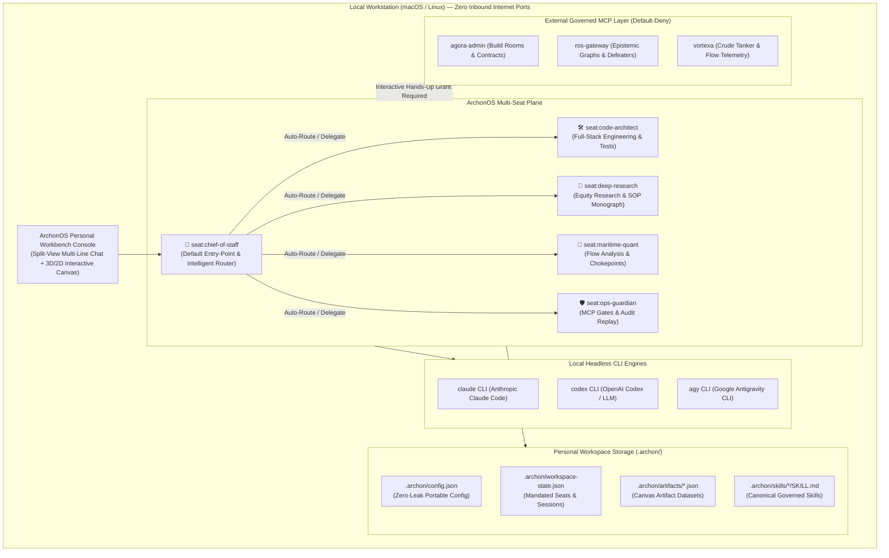

# ArchonOS (`@archon-os`) — Personal RSI Intelligent OS

<div align="center">

**[English](./README.md) | [简体中文 (Simplified Chinese)](./README.zh-CN.md)**

**[Quickstart Guide](./docs/en/QUICKSTART.md)** • **[System Architecture](./docs/en/ARCHITECTURE.md)** • **[Configuration & Governance](./docs/en/CONFIGURATION.md)** • **[Strategic Roadmap](./ROADMAP.md)** • **[Changelog](./CHANGELOG.md)**

</div>

---

**ArchonOS** is an open-source, standalone **Personal RSI Intelligent Operating System** running locally on your workstation (macOS / Linux). It seamlessly unifies **Chief of Staff Auto-Routing**, **Multi-Line Fluid Chat & Input Ergonomics**, **Local Headless Model Hands** (`claude`, `codex`, `agy`, `opencode`), **Default-Deny MCP Tool Federation**, **Interactive Canvas Artifact Quoting & Modification**, and **Harness2 Recursive Self-Improvement (RSI) Skills** into a single bilingual (`EN / 中文`) intelligent control console.

ArchonOS is designed as an autonomous, self-contained personal intelligent operating system. It operates completely independently without requiring or mandating external Warroom orchestrators, while retaining optional modular integration with external MCP networks, codebases, and Antigravity architect bridges whenever requested.

---

## ✨ Key Capabilities

1. **Mandatory Chief of Staff & Zero-Config Autonomous Init (`npm run init` / `npx archon init`)**:
   - **Pre-Seeded Chief of Staff (`seat:chief-of-staff`)**: Every ArchonOS instance boots with the Chief of Staff seat permanently initialized as the default conversational entry-point and orchestrator. Directives are automatically classified and routed to specialist seats (`code-architect`, `deep-research`, `maritime-quant`, `ops-guardian`) with shared cross-seat session context.
   - **Multi-Tenant Seat & Asset Privacy (Default Invariant)**: For external users and standard collaborators, specialist seats (`code-architect`, `maritime-quant`, etc.), private MCP connections, API keys, and custom operator skills are strictly hidden and isolated from visibility or direct access. Interactions funnel exclusively through the Chief of Staff unless explicit per-seat access or delegation permissions are authorized by the host operator.
   - **Autonomous Host Discovery**: Probes installed local CLI model hands (`claude`, `codex`, `agy`, `opencode`) across standard paths (`~/.local/bin`, `/opt/homebrew/bin`, `~/.npm-global/bin`, `$PATH`) and configures headless execution with zero plaintext credential leakage.
   - **Portable Configuration**: Writes `.archon/config.json` and seeds `.archon/skills/` starter Harness2 `SKILL.md` workflows.
2. **Multi-Line Intelligent Chat & Interactive Artifact Quoting (`💬 Quote to Modify`)**:
   - **Fluid Multi-Line Input Box**: Upgraded conversational interface with multi-line auto-expanding textarea support. Press `Enter` to send instructions immediately, or `Shift+Enter` to insert clean linebreaks for complex prompts, structured code blocks, and multi-paragraph directives.
   - **1-Click Artifact Quoting**: Added `💬 Quote to Modify` buttons across the Canvas topbar, viewport toolbars, file preview panels, and workspace browser rows.
   - **Natural-Language Artifact Evolution**: Quoting an artifact pins its metadata, staged source files (`.html`, `.md`, `.json`), and revision history (`rX`) directly into the Chat composer tray, enabling users to request additions, styling adjustments, or data updates that compile into revision `rX+1` in-place.
3. **Independent Operation & Optional Warroom Decoupling**:
   - **Self-Contained Runtime**: Runs completely standalone on your local workstation without external server dependencies or mandatory Warroom processes. Warroom connectivity is supported purely as an optional extension.
4. **External MCP Federation with Default-Deny Security (3 Onboarding Methods)**:
   - Connect any Model Context Protocol (MCP) server via:
     1. **Web UI Modal**: Left Sidebar ➔ *External MCPs* ➔ `+ Add MCP Server`.
     2. **Zero-Config Auto-Discovery**: Automatic pickup from `~/.gemini/antigravity/mcp/<serverName>`, `~/.cursor/mcp.json`, or `~/.claude/claude_desktop_config.json`.
     3. **REST API**: Programmatic registration via `POST /api/mcp/servers`.
   - **Default-Deny Enforcement**: Ungranted tool calls are deterministically blocked (`403 Forbidden`). Tools must be explicitly granted per-seat via interactive human authorization.
5. **Chat-to-Canvas Live Compiler & In-Place Document Evolution (`outputs/`)**:
   - Compile interactive 3D/2D visual Canvas artifacts with SHA-256 revision lineage (`r1 → rN`).
   - Sticky CLI hand session continuity keeps conversational context intact across follow-up turns, automatically modifying companion research reports (`.docx`, `.pdf`, `.md`) in-place with native visual vector diagrams.
6. **Antigravity Codebase Closed-Loop Bridge & Infinite RSI Cron (`🔗 Architect Loop`)**:
   - **Bidirectional Architect Loop**: Type `/architect <directive>` in Chat to automatically transmit structured architectural enhancements to the Antigravity Codebase Session.
   - **Automated Self-Improvement**: 2-hour recurring cron (`0 */2 * * *`) audits monorepo health, regenerates telemetry, and refines canonical skill workflows.
7. **Dual-Theme High-Contrast Simplism UI (`🌙 Dark` / `☀️ Light`)**:
   - Instant 1-click theme switcher between **Obsidian Dark** and **Paper Light** modes with synchronized Chart.js, Mermaid.js, and 3D Canvas rendering.
8. **Dual-Target Deployment & Remote-to-Local Sovereign Chat Bridge**:
   - **Local Workstation OR Cloudflare Remote**: Choose between 100% offline local workstation deployment (`127.0.0.1:8790`) or Cloudflare Edge Worker + Remote PWA console.
   - **Remote Sovereign Chat Bridge**: Submit chat turns directly from your mobile/remote PWA (`https://<worker>.workers.dev`), queued securely into Cloudflare R2 and claimed exclusively by your local MacBook daemon (`archon-sync-edge.mjs`). Local CLI hands (`agy`, `claude`, `codex`) execute with private data/tools/MCPs on-device, and reply back to the remote UI with live status updates (`QUEUED FOR MACBOOK` → `RUNNING ON MACBOOK` → `DONE`).
   - **Live Chat History Synchronization**: Two-way encrypted sync between local `workspace-state.json` and Cloudflare R2, with automatic 30s background sync watcher, manual 1-click sync badge, and separate local-hand execution readiness monitoring.

---

## 🏗️ System Architecture



---

## 🚀 Quickstart

### Option A: One-Line Autonomous Setup
```bash
git clone https://github.com/dmquant/archonos-pub.git
cd archon-os
npm install
npm run init
npm start
```

### Option B: Verification & Full Suite
```bash
# 1. Install dependencies & initialize workspace
npm install

# 2. Run autonomous host discovery (mandates Chief of Staff & probes CLI hands)
npm run init

# 3. Execute monorepo test suite (107/107 tests across 9 packages)
npm test

# 4. Start ArchonOS Web Console on http://127.0.0.1:8790
npm start
```

Open **`http://127.0.0.1:8790`** in your browser. Switch language between **English (`EN`)** and **Simplified Chinese (`中文`)** anytime from the top-right header toggle.

---

## 📦 Monorepo Package Structure

| Package | Runtime | Description |
| :--- | :--- | :--- |
| [`packages/archon-app`](./packages/archon-app) | HTML5 / ES2022 / Three.js | Bilingual Personal Workbench PWA, 3D Globe, Subgraph Explorer, Multi-Line Chat, and Artifact Quote-to-Modify UI |
| [`packages/archon-worker`](./packages/archon-worker) | Node.js / Cloudflare DO | `WorkspaceOrchestratorDO`, Local Hands Runner, Chief of Staff Router, and HTTP/SSE API Gateway |
| [`packages/archon-registry`](./packages/archon-registry) | Node.js ESM | Strict schema validator for Seats, MCP Servers (`secret://` handles), Grants, and Human-Ack gates |
| [`packages/archon-skills`](./packages/archon-skills) | TypeScript / Node.js | Harness2 3-valued epistemic skill eligibility verifier (`pass \| fail \| insufficient`, $n \ge 2, k = 3$) |
| [`packages/archon-canvas`](./packages/archon-canvas) | Node.js ESM | 5-Stage R2-First atomic artifact revision gate & HTML accessibility parity verifier |
| [`packages/archon-ledger`](./packages/archon-ledger) | Python 3 | Default-deny policy gate & SHA-256 hash-chained audit ledger (`policy_ledger.py`) |
| [`packages/archon-hands`](./packages/archon-hands) | Python 3 | Local CLI stream normalizer (`claude`, `codex`, `agy`, `opencode`), credential scrubber & lease manager |
| [`packages/archon-mesh`](./packages/archon-mesh) | Node.js ESM | Ed25519-signed `.archon-bundle` export/import with mandatory secret & raw trajectory stripping |
| [`packages/archon-cli`](./packages/archon-cli) | Node.js CLI | `archon` CLI (`archon init`, `archon up`, `archon status`, `archon hands probe`) |

---

## 📚 Bilingual Documentation Index

| Document | English | 简体中文 (Simplified Chinese) |
| :--- | :--- | :--- |
| **README Overview** | [README.md](./README.md) | [README.zh-CN.md](./README.zh-CN.md) |
| **Quickstart Guide** | [docs/en/QUICKSTART.md](./docs/en/QUICKSTART.md) | [docs/zh-CN/QUICKSTART.md](./docs/zh-CN/QUICKSTART.md) |
| **System Architecture** | [docs/en/ARCHITECTURE.md](./docs/en/ARCHITECTURE.md) | [docs/zh-CN/ARCHITECTURE.md](./docs/zh-CN/ARCHITECTURE.md) |
| **Configuration & Governance** | [docs/en/CONFIGURATION.md](./docs/en/CONFIGURATION.md) | [docs/zh-CN/CONFIGURATION.md](./docs/zh-CN/CONFIGURATION.md) |
| **Changelog & Versions** | [CHANGELOG.md](./CHANGELOG.md) | [CHANGELOG.zh-CN.md](./CHANGELOG.zh-CN.md) |

---

## 🛡️ Security & Privacy Invariants

- **Mandatory Seat Bootstrapping**: `seat:chief-of-staff` is immutably initialized on fresh installation, guaranteeing an operational orchestrator out of the box.
- **Seat, MCP & Skill Privacy Isolation**: Except for the Chief of Staff serving as the conversational interface, specialist seats (`seat:code-architect`, `seat:deep-research`, `seat:maritime-quant`, `seat:ops-guardian`), registered MCP server handles, and private skills are never exposed to external or guest users.
- **Zero Plaintext Secrets**: MCP credentials use opaque `secret://...` URIs. Secrets are never logged, exported, or embedded in client bundles.
- **Strict Localhost Binding**: Binds exclusively to `127.0.0.1` (`ARCHON_PORT=8790`), ensuring zero open inbound ports to public networks.

---

## 📄 License

Released under the [MIT License](./LICENSE).
