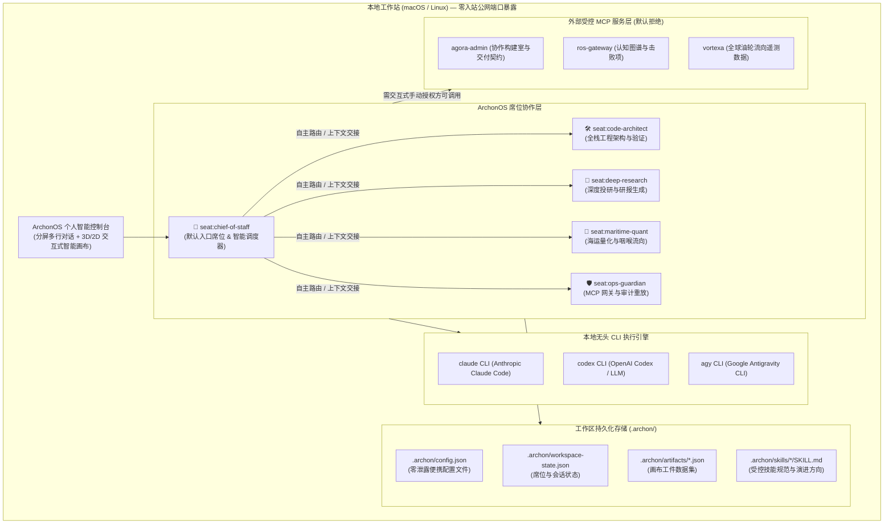

# ArchonOS (`@archon-os`) — 个人自进化智能操作系统

<div align="center">

**[English (英文)](./README.md) | [简体中文](./README.zh-CN.md)**

**[快速入门指南](./docs/zh-CN/QUICKSTART.md)** • **[系统架构文档](./docs/zh-CN/ARCHITECTURE.md)** • **[配置与治理指南](./docs/zh-CN/CONFIGURATION.md)** • **[战略路线图](./ROADMAP.zh-CN.md)** • **[更新日志](./CHANGELOG.zh-CN.md)**

</div>

---

**ArchonOS（智枢）** 是一套开源、在本地工作站（macOS / Linux）独立运行的**个人自进化智能操作系统（Personal RSI Intelligent OS）**。系统将 **幕僚长（Chief of Staff）自主路由**、**多行自由输入对话框**、**本机无头 CLI 模型执行手**（`claude`、`codex`、`agy`、`opencode`）、**默认拒绝（Default-Deny）的 MCP 工具联邦**、**工件引用对话即时修改（Quote-to-Modify）** 以及 **Harness2 递归自改进技能体系（RSI）** 深度整合为统一的双语（`中文 / EN`）智能控制台。

ArchonOS 专注于作为一套自包含的个人智能操作系统独立运行，完全解耦外部 Warroom 作战室强依赖，不需要亦不强制运行 Warroom；同时无缝支持按需接入外部 MCP 网络、本地代码库以及 Antigravity 架构师闭环。

---

## ✨ 核心特性

1. **新用户强制幕僚长与零配置自主初始化 (`npm run init` / `npx archon init`)**:
   - **预植入幕僚长席位 (`seat:chief-of-staff`)**：任何新用户安装初始化时，强制并持久化植入智枢幕僚长作为默认会话入口与调度器，指令自动分类并分发至专职席位（`code-architect`、`deep-research`、`maritime-quant`、`ops-guardian`），全席位共享统一上下文与工作区文件。
   - **席位、MCP 与技能隔离保护（默认安全不变式）**：除面向用户的幕僚长（Chief of Staff）作为统一交互门户之外，其他专职席位（如 `code-architect` 代码架构师、`deep-research` 深度投研等）、操作者配置的私有 MCP 接口以及自定义技能库对外部或普通用户默认完全不可见且不可直接越权访问，确保操作者核心能力与环境配置的安全隐私。
   - **主机执行手自动探测**：自动识别本地已安装的 CLI 引擎（`claude`、`codex`、`agy`、`opencode`），智能配置无头执行参数与超时熔断保护，杜绝任何个人绝对路径与密钥泄露。
   - **轻量便携配置**：自动生成 `.archon/config.json` 与 `.archon/skills/` 初始技能库。
2. **多行自由输入对话与工件引用对话修改 (`💬 引用修改 / Quote to Modify`)**:
   - **多行自由输入框**：输入框全新升级为多行自适应文本域，支持直接按 `Enter` 快速发送指令，或使用 `Shift+Enter` 灵活换行输入长段文字、结构化提示词与代码块。
   - **一键引用工件入对话**：在画布顶部导航栏、工件详情工具栏、文件预览面板以及工作区浏览器条目中，均内嵌 `💬 引用修改` 快捷动作。
   - **自然语言驱动工件演进**：点击后自动将工件元数据、源码文件（`.html`、`.md`、`.json`）及当前版本号（`rX`）锁定至对话输入托盘，支持操作者通过自然语言提出修改需求，直接原地编译生成 `rX+1` 新版本。
3. **独立自包含运行与 Warroom 解耦**:
   - **本地完全独立**：系统无需依赖外部云端常驻服务或特定外部 Warroom 进程，可作为独立的个人智能工作台单体运行；Warroom 协作被设计为按需启用的可选模块。
4. **默认拒绝安全机制的外部 MCP 工具联邦（3 种接入途径）**:
   - 支持通过以下三种方式无缝挂载任何标准 Model Context Protocol (MCP) 服务：
     1. **图形界面弹窗**：左侧导航栏 ➔ *外部 MCP 连接器* ➔ `+ 添加 MCP 服务`。
     2. **本地环境自动发现**：自动扫描并接入 `~/.gemini/antigravity/mcp/<服务名>`、`~/.cursor/mcp.json` 或 `~/.claude/claude_desktop_config.json`。
     3. **REST API 接口**：通过 `POST /api/mcp/servers` 编程式动态注册。
   - **默认拒绝（Default-Deny）管控**：未明确授权的工具调用一律严格阻断（`403 Forbidden`），需经由操作者交互式显式授权至特定席位方可调用。
5. **对话即画布实时编译器与研报文档原地更新 (`outputs/`)**:
   - 支持在对话中直接编译兼具 3D/2D 交互的 Canvas 工件，具备完整的 SHA-256 版本校验链条（`r1 → rN`）。
   - **粘性 CLI 会话与文档原地演化**：多轮对话自动继承底层 CLI 会话上下文，针对此前生成的研报（`.docx`、`.pdf`、`.md`）执行原地更新，并保留全部矢量架构拓扑图。
6. **Antigravity 代码库闭环桥接与无限 RSI 循环 (`🔗 代码架构闭环`)**:
   - **双向架构闭环**：在对话中输入 `/architect <需求>`，席位自动将技术规格反馈封装并派发至 Antigravity 代码库会话执行。
   - **定时自主进化**：2 小时周期定时任务（`0 */2 * * *`）自动巡检仓库健康度、刷新系统指标并持续迭代优化技能 SOP。
7. **双主题极简高对比度界面 (`🌙 深色模式` / `☀️ 浅色纸质模式`)**:
   - 一键秒级切换深邃黑曜石与纸质高对比度模式，Chart.js、Mermaid 图表及 3D 视口自适应渲染。
8. **双目标部署与远端-本地主权对话调度桥接 (Dual-Target & Remote Sovereign Chat Bridge)**:
   - **本地工作站或 Cloudflare 边缘部署**：支持选择 100% 本地隔离运行（`127.0.0.1:8790`）或部署至 Cloudflare Edge Worker + 远端 PWA 控制台。
   - **远端安全调度本地 CLI 执掌**：在手机或移动浏览器端访问 Cloudflare 远端控制台（`https://<worker>.workers.dev`）直接输入对话，任务经由 R2 安全入队并由 MacBook 本地守护进程（`archon-sync-edge.mjs`）独占认领执行。本机模型手（`agy`、`claude`、`codex`）在私有工作区和本地 MCP 环境执行后，秒级流式回传结果并呈现状态实时联动（`QUEUED FOR MACBOOK` → `RUNNING ON MACBOOK` → `DONE`）。
   - **对话历史双向镜像同步与健康看板**：支持本地 `workspace-state.json` 与云端 R2 自动 30s 定时增量同步、一键手动刷新徽标，并独立呈现本地执行手就绪状态（Custodian Readiness）。

---

## 🏗️ 系统架构图



---

## 🚀 快速上手

### 推荐流程：一键自主安装启动
```bash
git clone https://github.com/dmquant/archonos-pub.git
cd archon-os
npm install
npm run init
npm start
```

### 完整验证与开发者流程
```bash
# 1. 安装项目依赖并触发自动预检
npm install

# 2. 运行自主环境发现（强制初始化幕僚长席位，探测本地 CLI 执行手）
npm run init

# 3. 运行跨语言全量测试套件（9 个子包共 107/107 测试全部通过）
npm test

# 4. 启动 ArchonOS 控制台服务 (默认端口 8790)
npm start
```

在浏览器中访问 **`http://127.0.0.1:8790`** 即可使用。随时可通过右上角切换 **简体中文 (`中文`)** 与 **English (`EN`)**。

---

## 📦 Monorepo 子包结构说明

| 子包名称 | 运行环境 | 功能与职责说明 |
| :--- | :--- | :--- |
| [`packages/archon-app`](./packages/archon-app) | HTML5 / ES2022 / Three.js | 双语智能控制台 PWA、3D 动态地球、ROS 子图网络探索器、多行输入与工件引用修改组件 |
| [`packages/archon-worker`](./packages/archon-worker) | Node.js / Cloudflare DO | 核心编排器 `WorkspaceOrchestratorDO`、幕僚长路由系统及 HTTP/SSE 网关 |
| [`packages/archon-registry`](./packages/archon-registry) | Node.js ESM | 席位、MCP 密钥句柄、授权策略及交互式审批关卡的高完整性校验器 |
| [`packages/archon-skills`](./packages/archon-skills) | TypeScript / Node.js | Harness2 三值认知技能验证器（`pass \| fail \| insufficient`, $n \ge 2, k = 3$） |
| [`packages/archon-canvas`](./packages/archon-canvas) | Node.js ESM | 5 阶段 R2-First 原子化工件版本推进引擎与 HTML 可访问性平权审计器 |
| [`packages/archon-ledger`](./packages/archon-ledger) | Python 3 | 默认拒绝策略拦截器与基于 SHA-256 哈希链的防篡改审计账本 |
| [`packages/archon-hands`](./packages/archon-hands) | Python 3 | 本地 CLI 执行手流归一化、密钥敏感信息脱敏与执行租约管理 |
| [`packages/archon-mesh`](./packages/archon-mesh) | Node.js ESM | 基于 Ed25519 签名的 `.archon-bundle` 导出与导入，强制剔除敏感密钥与轨迹 |
| [`packages/archon-cli`](./packages/archon-cli) | Node.js CLI | `archon` 命令行工具（`archon init`、`archon up`、`archon status`） |

---

## 📚 双语文档导航索引

| 文档分类 | English (英文) | 简体中文 (Simplified Chinese) |
| :--- | :--- | :--- |
| **README 项目总览** | [README.md](./README.md) | [README.zh-CN.md](./README.zh-CN.md) |
| **快速入门指南** | [docs/en/QUICKSTART.md](./docs/en/QUICKSTART.md) | [docs/zh-CN/QUICKSTART.md](./docs/zh-CN/QUICKSTART.md) |
| **系统架构文档** | [docs/en/ARCHITECTURE.md](./docs/en/ARCHITECTURE.md) | [docs/zh-CN/ARCHITECTURE.md](./docs/zh-CN/ARCHITECTURE.md) |
| **配置与治理指南** | [docs/en/CONFIGURATION.md](./docs/en/CONFIGURATION.md) | [docs/zh-CN/CONFIGURATION.md](./docs/zh-CN/CONFIGURATION.md) |
| **更新日志与版本记录** | [CHANGELOG.md](./CHANGELOG.md) | [CHANGELOG.zh-CN.md](./CHANGELOG.zh-CN.md) |

---

## 🛡️ 安全与环境准则

- **席位强制植入**：初始安装自动持久化 `seat:chief-of-staff`，确保系统开箱即具备全权总览协调能力。
- **席位、MCP 与技能隔离保护**：除统一交互入口幕僚长席位外，专职席位（`seat:code-architect`、`seat:deep-research`、`seat:maritime-quant` 等）、已注册的 MCP 句柄与私有自定义技能对外部访客或普通用户默认完全不可见，杜绝越权探测。
- **零明文敏感密钥**：外部 MCP 鉴权完全采用 `secret://...` 不透明句柄，从不硬编码、输出或写入前端。
- **严格回环监听**：服务仅绑定 `127.0.0.1` 本地回环网络，杜绝任何未经授权的外部网络穿透风险。

---

## 📄 开源许可证

本项目基于 [MIT License](./LICENSE) 协议完全开源。
