# ArchonOS Strategic Roadmap (`v0.1` → `v1.0`)

> **Positioning**: **Personal & Small-Team Intelligent OS (个人与小团队自进化智能操作系统)** — Local-first or Cloudflare Remote dual-target deployment, default-deny MCP governance, atomic Canvas revisioning (`r1 → rN`), and continuous Recursive Self-Improvement (`Harness2 k=3`) orchestrated by a mandatory **Chief of Staff (`seat:chief-of-staff`)**.

---

## Architecture & Milestone Evolution Topology

```mermaid
flowchart LR
  subgraph Completed["✅ Completed Milestones (v0.1.000 – v0.1.005)"]
    M1["M1: 9-Package Kernel
& Model Hands
(v0.1.000)"] --> M2["M2: CoS Orchestrator
& Quote-to-Modify r1→rN
(v0.1.001)"]
    M2 --> M3["M3: Infinite Fractal RSI
& Closed-Loop Bridge
(v0.1.002–003)"]
    M3 --> M4["M4: Full-Chain Privacy
& Decoupled Datasets
(v0.1.004)"]
    M4 --> M5["M5: Autonomous Git
& Immutable Safe Mode
(v0.1.005)"]
  end

  subgraph ImmediatePriorities["🎯 Immediate Strategic Priorities On The Table (v0.2 – v0.3)"]
    P2["Phase 2 (v0.2.x)
Dual-Target Deployment
Local ↔ Cloudflare Remote
(HandLeaseDO Pairing)"] --> P3["Phase 3 (v0.3.x)
Multi-User Secure Channels
& Team/Group Workspaces
(ArchonMailboxDO + Mesh)"]
  end

  subgraph NextHorizons["🚀 Expansion Horizons (v0.4 – v1.0)"]
    P4["Phase 4 (v0.4.x)
Parallel Multi-Seat DAG
& Bidirectional Canvas"] --> P5["Phase 5 (v1.0.0)
Worktree Self-Healing
Personal & Team RSI OS GA"]
  end

  M5 ==> P2
  P3 ==> P4
```

---

## Part I — Achieved Milestones (`v0.1.000` – `v0.1.005`)

| Milestone | Version | Core Deliverables & Verification | Status |
| :--- | :---: | :--- | :---: |
| **M1: 9-Package Monorepo & Local Model Hands Kernel** | `v0.1.000` | Bootstrapped `@archon-os/{app,worker,registry,skills-rsi,canvas,ledger,hands,mesh,cli}`; headless CLI stream normalization (`claude`, `codex`, `agy`, `opencode`) and SHA-256 hash-chained policy ledger. | ✅ Complete |
| **M2: Chief of Staff Mandate & Interactive Workbench** | `v0.1.001` | Pre-seeded mandatory `seat:chief-of-staff` across `archon-init.mjs`; added `💬 Quote to Modify` (`r1 → rN` atomic revisions), multi-line `Shift+Enter` chatbox, cross-seat shared context, and Warroom decoupling. | ✅ Complete |
| **M3: Infinite Fractal RSI & Closed-Loop Architect Bridge** | `v0.1.002`–`003` | Bidirectional `/architect` bridge (`scripts/architect-bridge.mjs`), 2-hour autonomous RSI rotation across all Seats, `Harness2 k=3` epistemic skill verification, and Mermaid 10.9 DOM isolation. | ✅ Complete |
| **M4: Full-Chain Privacy & Workspace Decoupling** | `v0.1.004` | Decoupled operator-owned datasets (`.archon/datasets/*`), local Canvas artifacts, private skills, and memories from public clones. Dynamic UI registry hydration + isolated fresh-clone test suite (`23/23 PASS`). | ✅ Complete |
| **M5: Autonomous Git Self-Evolution & Safe-Mode Recovery** | `v0.1.005` | Test-gated autonomous commit & push (`/api/git/commit-push`, `/commit`, `/push`), Golden Checkpoint tagging (`archon-golden-*`), and two-tier Immutable Safe Mode (`/safemode`, `/recover` via `scripts/archon-safe-recover.mjs`). | ✅ Complete |

---

## Part II — Immediate Strategic Priorities On The Table (Aligned with `seat:chief-of-staff`)

### Phase 2 (`v0.2.x`) — Dual-Target Deployment: Local Workstation ↔ Cloudflare Remote
1. **Target Selection Architecture (`Local 127.0.0.1:8790` OR `Cloudflare Remote`)**:
   - Operator chooses runtime target during `npm run init` or config toggle:
     - **Target A (Local Workstation)**: Local Node.js server at `http://127.0.0.1:8790` with direct stdio pipe to local CLI hands (`claude`, `codex`, `agy`, `opencode`).
     - **Target B (Cloudflare Remote)**: Edge deployment via `wrangler deploy` deploying `@archon-os/worker` on Cloudflare Workers and frontend on Cloudflare Pages / Workers Assets with 100% Worker API parity.
2. **`HandLeaseDO` Remote-to-Local CLI Hand Reverse Pairing**:
   - Cloudflare Worker utilizes a stateful Durable Object (`HandLeaseDO`) establishing an authenticated, multiplexed WebSocket reverse-tunnel back to the operator's local workstation daemon (`archon hand daemon`).
   - Enables edge-hosted Web UI and remote requests to transparently dispatch tasks to local model hands (`claude`, `codex`, `agy`, `opencode`) running with local credentials, local filesystem tools, and zero API token exposure.
3. **Unified Storage & Edge Parity Layer**:
   - Dual-mode persistence adapters: Local filesystem (`.archon/workspace-state.json`) ↔ Cloudflare D1 / KV / R2 storage with transactional state consistency.

### Phase 3 (`v0.3.x`) — Multi-User Coordination & Team/Group Workspaces
1. **`ArchonMailboxDO` & 1-Click E2EE / Ed25519 Secure Channels**:
   - Edge-native ephemeral & persistent messaging hub powered by Cloudflare Durable Objects (`ArchonMailboxDO`).
   - 1-click Ed25519 authenticated key-exchange and end-to-end encrypted (E2EE) secure channels for peer-to-peer user and cross-Chief-of-Staff (`CoS_A ↔ CoS_B`) federation.
2. **Multi-User Collaboration & Team/Group Rooms (`team:<id>` / `group:<id>`)**:
   - Collaborative multi-user workspaces supporting shared Canvas artifacts, real-time revision broadcasts (`r1 → rN`), and synchronized group memory ledgers (`.archon/group-memories/`).
   - Group-level default-deny MCP policy enforcement and access-control lists (ACL) preserving privacy of personal operator seats.
3. **Federated Provenance & Scoped Capability Leasing (`@archon-os/mesh`)**:
   - 4-provenance bundle exchange (author, issuing station, signature, verification hash) for sharing sanitized skills and canvas views.
   - Time-bound, scoped seat capability leases: temporary delegation of specialist tasks (e.g. loaning `seat:maritime-quant` analysis capabilities to an allied team member).

---

## Part III — Next Expansion Horizons

### Phase 4 (`v0.4.x`) — Parallel Multi-Seat DAG & Bidirectional Canvas Bridge
1. **Chief of Staff Parallel DAG Fan-Out & Subtask Telemetry**:
   - Upgrade `routeTaskViaChiefOfStaff` from sequential delegation to concurrent multi-seat DAG execution (`seat:deep-research` + `seat:maritime-quant` + `seat:code-architect` running simultaneously).
2. **Belnap 4-Valued Contradiction Gate (`T / F / Both / Neither`)**:
   - Automated epistemic conflict detection across quantitative feeds and specialist outputs prior to CoS synthesis.
3. **Two-Way Canvas-to-Chat State Bridge (`window.archonCanvasBridge`) & Visual Diff Studio (`rX ↔ rY`)**:
   - Bidirectional event flow from Canvas widgets back to chat context, side-by-side artifact diffing, and multi-format compilers.

### Phase 5 (`v1.0.0`) — Worktree Self-Healing Personal & Team RSI OS (GA)
1. **Isolated Git Worktree Self-Patching Sandbox**:
   - Background anomaly detection synthesizes fixes in isolated worktrees, runs full 107/107 unit tests and `Harness2 k=3` replay before CoS promotion.
2. **Sub-Second Zero-Downtime Auto-Rollback**:
   - High-availability recovery back to the latest `archon-golden-*` checkpoint if runtime health checks trip.

---

## Part IV — Chief of Staff (`seat:chief-of-staff`) Orchestration Protocol

- **Single Conversational & Dispatch Entrypoint**: All user prompts, team channel dispatches, and `/architect` evolution requests pass through `seat:chief-of-staff`.
- **Dual-Target Execution Transparency**: CoS automatically detects whether running on `Local Workstation` or `Cloudflare Remote + HandLeaseDO` and routes CLI model hands seamlessly.
- **Privacy & Federation Invariant**: Personal datasets, local CLI tokens, and proprietary memories remain locked in local `.archon/` storage; only cryptographically signed, operator-approved bundles are exchanged across team channels.
