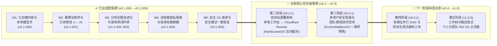

# ArchonOS 战略路线图 (`v0.1` → `v1.0`)

> **系统定位**：**个人与小团队自进化智能操作系统 (Personal & Small-Team Intelligent OS)** —— 本地工作站或 Cloudflare Remote 双目标部署、默认拒绝 (Default-Deny) 的 MCP 权限治理、原子化 Canvas 工件版本演进 (`r1 → rN`)，以及由强制预置的**智枢幕僚长 (`seat:chief-of-staff`)** 统筹调度的持续递归自进化 (`Harness2 k=3`)。

---

## 架构与里程碑演进拓扑

---

## 第一部分 — 已达成核心里程碑 (`v0.1.000` – `v0.1.005`)

| 里程碑 | 版本号 | 核心交付物与工程核验指标 | 状态 |
| :--- | :---: | :--- | :---: |
| **M1: 九包微内核与本地模型手 (Model Hands)** | `v0.1.000` | 构建 `@archon-os/{app,worker,registry,skills-rsi,canvas,ledger,hands,mesh,cli}`；打通 `claude`、`codex`、`agy`、`opencode` 流式归一化与 SHA-256 哈希链审计账本。 | ✅ 已完成 |
| **M2: 幕僚长强制预置与交互式工作台** | `v0.1.001` | 在 `archon-init.mjs` 强制初始化 `seat:chief-of-staff`；实现 `💬 引用修改 (Quote to Modify)` (`r1 → rN` 原子递增)、多行 `Shift+Enter` 输入框、跨席位共享上下文及 Warroom 解耦。 | ✅ 已完成 |
| **M3: 分形无限自进化 (RSI) 与架构师闭环桥** | `v0.1.002`–`003` | 建立双向 `/architect` 闭环桥 (`scripts/architect-bridge.mjs`)、每 2 小时全席位轮转 RSI 自进化、`Harness2 k=3` 技能认知核验，以及 Mermaid 10.9 异常 DOM 自动清理。 | ✅ 已完成 |
| **M4: 全链路隐私隔离与工作区解耦** | `v0.1.004` | 将操作者私有数据集 (`.archon/datasets/*`)、本地专属画布工件、私有技能与记忆同公共仓库彻底解耦；前端导航按实际注册项动态渲染，新增隔离新克隆安装测试 (`23/23 PASS`)。 | ✅ 已完成 |
| **M5: 自主 Git 演进与双层不可变安全模式恢复** | `v0.1.005` | 支持测试门控的自主提交与推送 (`/api/git/commit-push`、`/commit`、`/push`)、黄金检查点标签 (`archon-golden-*`)，以及双层不可变安全模式与席位舰队一键恢复 (`/safemode`、`/recover`)。 | ✅ 已完成 |

---

## 第二部分 — 当前核心战略优先级聚焦（与 `seat:chief-of-staff` 深度对齐）

### 第二阶段 (`v0.2.x`) — 双目标部署架构：本地工作站 ↔ Cloudflare Remote
1. **双部署目标自主选择架构 (`Local 127.0.0.1:8790` 或 `Cloudflare Remote`)**：
   - 操作者可在初始化配置 (`npm run init` 或配置面板) 中自由指定运行环境：
     - **目标 A（本地工作站）**：本地 Node.js 进程监听 `http://127.0.0.1:8790`，直连本地 stdio 管道驱动 CLI 模型手 (`claude`, `codex`, `agy`, `opencode`)。
     - **目标 B（Cloudflare Remote 边缘运行）**：通过 `wrangler deploy` 将 `@archon-os/worker` 部署在 Cloudflare Workers，前端挂载于 Cloudflare Pages / Workers Assets，保持 100% Worker API 行为同构。
2. **`HandLeaseDO` 远端至本地 CLI 模型手反向配对通道**：
   - 借助 Cloudflare 有状态 Durable Object (`HandLeaseDO`)，构建带鉴权的多路复用 WebSocket 反向安全隧道，直连操作者本地工作站守护进程 (`archon hand daemon`)。
   - 边缘端 Web 界面发起的席位调度请求可无缝透明穿透至本地 CLI 手执行，直接利用本地模型凭证与本地文件系统工具，严防云端 API Key 泄露。
3. **多模态同构存储抽象适配器**：
   - 本地文件系统状态 (`.archon/workspace-state.json`) 与 Cloudflare D1 / KV / R2 之间的双向事务一致性存储适配。

### 第三阶段 (`v0.3.x`) — 多用户安全信道与团队/群组协作空间
1. **`ArchonMailboxDO` 与一键端到端加密 (E2EE / Ed25519) 安全信道**：
   - 基于 Cloudflare Durable Objects (`ArchonMailboxDO`) 构建边缘原生信箱协调中心。
   - 一键生成 Ed25519 签名与协商密钥，建立对等用户 (P2P) 及跨幕僚长 (`CoS_A ↔ CoS_B`) 的端到端加密通信信道。
2. **多用户协同与团队/群组工作空间 (`team:<id>` / `group:<id>`)**：
   - 提供共享 Canvas 画布工件、实时多端版本广播 (`r1 → rN`) 以及协同沉淀的群组记忆账本 (`.archon/group-memories/`)。
   - 实施群组级默认拒绝 (Default-Deny) MCP 工具访问控制策略，严格隔离操作者个人席位隐私。
3. **联邦溯源资产交换与能力借调机制 (`@archon-os/mesh`)**：
   - 规范四元溯源资产包（作者、发令站台、数字签名、校验哈希），安全共享经过脱敏的自研技能与画布研报。
   - 席位能力临时安全借调机制：允许短期有界将专属分析席位（例如 `seat:maritime-quant`）的分析能力授权租借给协同团队成员。

---

## 第三部分 — 下一阶段纵深远景规划

### 第四阶段 (`v0.4.x`) — 多席位并行 DAG 调度与双向生成式画布工坊
1. **幕僚长并行 DAG 调度与实时子任务遥测**：
   - 升级 `routeTaskViaChiefOfStaff` 为多席位并行 DAG 协同（例如 `seat:deep-research` + `seat:maritime-quant` + `seat:code-architect` 并发执行并由幕僚长统一收敛）。
2. **Belnap 四值逻辑跨席位矛盾门控 (`T / F / Both / Neither`)**：
   - 自动检测各专家席位输出中的指标分歧、时间戳过期或证据冲突，经幕僚长认知仲裁后再签发最终版本。
3. **双向画布状态桥 (`window.archonCanvasBridge`) 与版本差异对比器 (`rX ↔ rY`)**：
   - Canvas 控件状态双向流式回传对话框上下文；提供工件版本间的源码与视觉差异对比。

### 第五阶段 (`v1.0.0`) — 工作树沙箱自愈式个人与团队 RSI 操作系统正式版 (GA)
1. **独立 Git Worktree 沙箱自修复机制**：
   - 后台巡检捕获异常后，在隔离 Worktree 中自动合成补丁并跑通单测与 Harness2 验证，提交幕僚长晋升为新黄金检查点。
2. **亚秒级零停机自动回滚**：
   - 晋升后若健康探针异常，自动回滚至最新 `archon-golden-*` 黄金检查点。

---

## 第四部分 — 智枢幕僚长 (`seat:chief-of-staff`) 统帅执行准则

- **唯一入口与透明路由**：操作者交互、群组协作分发与 `/architect` 演进请求统归幕僚长统一调度；幕僚长自适应识别 Local 进程或 Cloudflare Remote + HandLeaseDO 拓扑。
- **演进绝对安全门控**：代码自主提交与技能晋升必须 100% 跑通测试套件、Harness2 k=3 认知重放以及不可变安全模式校验。
- **隐私与协作绝对边界**：私有数据集与本地 CLI 密钥永久驻留本地 `.archon/`；群组信道仅交互已签名脱敏的工件与认知成果。
