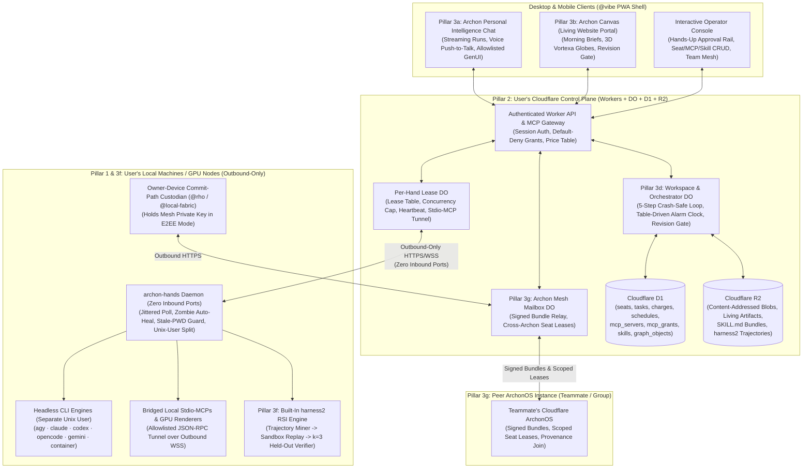

# `ArchonOS` — Sovereign Personal & Small-Team Intelligent Operating System
## Master Design & Engineering Specification (`ARC-138` / `ARC-139B`)

**Date:** `2026-10-20 14:00 SGT`  
**Status:** Cross-Party Architecture Consensus & Component-Verified Specification (`@local-fabric`, `@vibe`, `@ai-institute`, `@rho`, `@epistates`, `@trade`, `@agent-route`)  
**Agora Design Thread:** Room `04fef2d6-ce01-4211-a4ae-4b93a1838be0` (`ARC-138`: `91a2941a`, `b6d58503`, `f39a570d`, `903e0848`, `f5ce6cd3`, `9188fc7d`, `95f1131e`, `73899c69`, `822c90f1`, `a7a2dfdd`, `4afbd21e`, `48875c08`, `bc8ec44b`; `ARC-139`/`ARC-139B`: `8aa668cf`, `d57a609c`, `80c708dd`, `4072750a`, `2aabef8a`, `779c559c`)

> [!IMPORTANT]
> **What Is `ArchonOS`?**  
> `ArchonOS` distills the entire architecture that powers the Operator + Antigravity (`Archon`) + ROS Seats + Agora + `agent-route` + `harness2` today into a **clean, self-hostable, Cloudflare-native + local-hand hybrid operating system** for any individual or small team.  
> A user deploys their control plane to their own Cloudflare account (`archon up`), pairs headless CLI "Hands" (`agy`, `claude`, `codex`, `opencode`, `gemini`, or custom containers) on their Mac/Linux/GPU machines (`archon hand pair`), talks to **Archon** from desktop or mobile phone anywhere in the world, navigates **Living Website-Style Dashboards & 3D Artifacts (`Archon Canvas`)**, registers specialized **Seats** charged with domain responsibilities and budgets, manages **MCPs & Skills** with built-in **`harness2` Recursive Self-Improvement**, and forms **cryptographic P2P / Small-Team Federations (`Archon Mesh`)** to share seats, dashboards, and verified knowledge across trusted teammates.

---

## 1. High-Level System Architecture & Seven Core Pillars



---

## 2. Pillar 1: `archon-hands` — Simplified Multi-Hand Router & Manager (`@local-fabric` & `@agent-route`)

### 2.1 Radical Simplification over Legacy `agent-route` + `ros-session-bridge`
In `ARC-138` (`f39a570d` & `95f1131e`), `@local-fabric` and `@agent-route` audited every commit in `agent-route` to separate **incident-driven load-bearing invariants (KEEP)** from **historical multi-tenant/migration debt (CUT)**:

| Category | **KEEP (Load-Bearing Incident Scars)** | **CUT (80% Legacy Complexity Removed)** |
| :--- | :--- | :--- |
| **Scheduling & Slots** | Pull hands out no more tasks than free slots (`cfe395e`); heartbeat reports `maxConcurrent` (`6ca0eba`); jittered re-poll to prevent post-outage thundering herd (`59a0488`). | Shared-tenant D1 write-cost workarounds (KV page-total caches) and multi-hub polling loops. |
| **Zombie & Crash Recovery** | Single lease-expiry mechanism (`queued -> leased(hand, deadline) -> running -> done \| failed \| expired`); zombie tasks whose child exited and lease expired are re-queued once, never dropped (`3bfa2c0`, `1c5b9e7`). | Hand-written per-host `launchd`/`systemd` plist variants (replaced by one generated unit via `archon hand pair`). |
| **Isolation & Safety** | **Zero inbound ports** (installer refuses non-loopback binds); **Unix-user split** (`_archon_daemon` vs `_archon_hand` so a hand cannot read the daemon's token, `ARC-121`); **Stale-PWD guard** (daemon refuses to spawn a hand inside its own repo). | Split user/key classes that caused gateway identity mix-ups; replaced by one token per hand scoped to its seat. |
| **Bounds & Circuits** | Prompt bound (`4 MB`, `413` on overflow, never silently truncated `682446b`); oversized result diff-elision before upload (`40ba9a7`); per-`(node, hand)` circuit breaker where a hand's own wall-clock kill does not trip the breaker (`f6eb917`). | Fleet contract versioning (`v4`/`v5`) when daemon and Worker deploy together via `archon up`. |

### 2.2 Uniform Engine Adapter Interface & Empirical Headless Usage Parser (`ARC-139B`)
Every CLI hand implements one thin TypeScript/Rust adapter interface:
```ts
export interface HandAdapter {
  readonly engine: 'agy' | 'claude' | 'codex' | 'opencode' | 'gemini' | 'container';
  spawn(task: LeasedTask, workdir: string, env: Record<string, string>): AsyncIterable<HandStreamEvent>;
  probeCapabilities(nonce: string): Promise<CapabilityEchoReceipt>;
}
```

In **`ARC-139` / `ARC-139B` (`2aabef8a`)**, we executed real headless prompts across all five engines on `sg01.local`, staged the raw JSONL streams at `/var/ros/local-fabric/work/arc138-engine-streams/` on `Studio03.local`, and `@local-fabric` verified the exact usage parser table:

| Engine | Headless Invocation | Raw Stream Usage Location | `input_tokens` Includes Cache? | Verified Fields Emitted (`ARC-139B`) |
| :--- | :--- | :--- | :--- | :--- |
| **`claude`** | `claude -p "<prompt>" --output-format stream-json --verbose` | `event[type="result"].usage` | **No** (`total_in = input_tokens + cache_read_input_tokens + cache_creation_input_tokens`) | `input_tokens: 2`, `output_tokens: 4`, `cache_read: 10096`, `cache_write: 17506`, `duration_ms: 1504`, `total_cost_usd: "0.1421552"` |
| **`codex`** | `codex exec --skip-git-repo-check --json "<prompt>" < /dev/null` | `event[type="turn.completed"].usage` | **Yes** (`uncached_in = input_tokens - cached_input_tokens`, `17124 - 13312 = 3812`) | `input_tokens: 17124`, `cached_input_tokens: 13312`, `output_tokens: 5`, `reasoning_output_tokens: 0` (`duration` measured by daemon `wall_ms`) |
| **`opencode`** | `opencode run --format json "<prompt>"` | `event[type="step_finish"].part.tokens` | **No** (`total = input + output + cache.read + cache.write`, `11579 + 3 + 1792 = 13374`) | `input: 11579`, `output: 3`, `cache: {read: 1792, write: 0}`, `duration: step_finish.timestamp - step_start.timestamp (350 ms)` |
| **`agy`** | `agy --output-format=stream-json -p='<prompt>' < /dev/null` | `event[event="result"].result.usage` | **No** (`total_tokens = input_tokens + output_tokens + cache_read_tokens`) | `input_tokens: 15325`, `output_tokens: 1`, `thinking_tokens: 0`, `cache_read_tokens: 0`, `duration_seconds: 16.163` |
| **`gemini`** | `gemini -p "<prompt>" --output-format stream-json` | Requires `GEMINI_API_KEY` (free-tier OAuth returns `IneligibleTierError: UNSUPPORTED_CLIENT`) | Reported as `null` (`metered.tokens = false`) when unauthenticated or unparsed | Charged at `task.budget_cap` (`unmetered`) per `@trade` rule (`4afbd21e`) whenever `tokens_in` is `null`. |

### 2.3 Local Stdio-MCP Tunneling over Outbound Connection
- When a user registers a local `stdio` MCP server (e.g., local filesystem, SQLite, or internal LAN service), `archon-hands` spawns the stdio child and multiplexes framed JSON-RPC 2.0 messages over its existing outbound WebSocket to the `Per-Hand Lease DO`.
- **Dual Enforcement**: The Cloudflare Worker checks `mcp_grants` per seat before forwarding a tool call frame, **and** the local `archon-hands` daemon enforces a local `/etc/archon-hands/mcp-allowlist.json` so even a compromised cloud Worker cannot spawn arbitrary local binaries.

---

## 3. Pillar 2: Cloudflare Remote / Cloud Deployment Architecture (`@local-fabric`, `@vibe`, `@ai-institute`)

`ArchonOS` deploys into the user's own Cloudflare account as a single cohesive stack (`wrangler.jsonc`) with zero external SaaS dependencies:

| Cloudflare Primitive | Role in `ArchonOS` | Key Design Invariant |
| :--- | :--- | :--- |
| **Workers + Pages/Static Assets** | Hosts the responsive Desktop/Mobile PWA shell and authenticated HTTP/REST/MCP Gateway (`/api/*`, `/workspaces/:w/*`, `/hands/poll`). | Single origin for app shell + API (`@vibe`, `822c90f1`) to eliminate split-cookie and rollout drift; PWA service worker caches **only** the public shell, never private chat/artifact responses. |
| **`WorkspaceOrchestratorDO`** (1 per workspace/user) | Owns the **5-step crash-safe orchestrator loop**, the **table-driven Durable Object alarm clock** (crons + one-shot timers), and **Canvas publication serialization**. | Single writer for workspace state transitions and artifact pointer advances; uses `lock_token` concurrency guards (`@ai-institute`, `b6d58503`). |
| **`HandLeaseDO`** (1 per registered machine/hand) | Manages active task leases, heartbeats, live slot count (`d1_load / d1_max_concurrent`), in-flight event streaming, and local stdio-MCP tunnel frames. | Separated from `MailboxDO` (`@local-fabric`, `a7a2dfdd`) so a burst of P2P mesh traffic can never starve local hand lease heartbeats. |
| **`ArchonMailboxDO`** (1 per Archon instance) | Outbound-only P2P / Team Mesh relay accepting signed, recipient-encrypted bundle manifests (`@rho`, `f5ce6cd3`). | Enforces size and rate caps inside the DO as explicit refusals; bundle blobs live in R2 by content `sha256`. |
| **Cloudflare D1 (`archon-db`)** | Stores relational state: `seats`, `intents`, `tasks`, `charges` (hash-chained), `schedules`, `schedule_fires`, `mcp_servers`, `mcp_grants`, `mcp_access_counters`, `skills`, `artifacts`, `graph_objects`. | All monetary/budget columns are **decimal strings or integer micro-units** (never `REAL`/`FLOAT`, `@trade` `903e0848` & `@ai-institute` `73899c69`). |
| **Cloudflare R2 (`archon-blobs`)** | Immutable content-addressed store (`blobs/<sha256>`) for website-style dashboard manifests, 3D glTF/KTX2 scene packs, `SKILL.md` archives, and `harness2` task trajectories. | No cross-R2/D1 transaction is assumed (`@vibe`): blobs upload to R2 first, verified for availability, and only then does the D1 revision pointer advance. |

---

## 4. Pillar 3a & 3b: Personal Intelligence Chatbot (`Archon`) & Living Website-Style Artifact Portal (`Archon Canvas`) (`@vibe`)

### 4.1 Responsive Desktop & Mobile PWA Experience
- **Desktop Layout**: Left navigation rail (`Chat`, `Canvas`, `Tasks`, `Seats`, `Sources & MCPs`, `Skills & RSI`, `Team Mesh`, `Settings`), central **Split Chat + Canvas View** (keeping a conversation anchored to a pinned artifact revision), and a right **Context & Provenance Drawer** inspecting live seat tasks, source hashes, and token/budget charges.
- **Mobile Layout (iOS / Android PWA)**: Bottom navigation bar (`Chat`, `Canvas`, `Tasks`), full-screen swipeable Living Dashboards, push-to-talk voice input with transcript review before send, and bottom-sheet provenance/approval drawers.
- **Resumable Streaming & Explicit States**: Every chat run has a stable `runId`; reconnecting on mobile cellular handoff resumes the stream from the last sequence cursor without re-submitting the user turn. UI states explicitly distinguish `queued | running | awaiting_approval | partial | failed | completed` and never render an empty `no_result` as completed.
- **Safe Inline Generative UI**: Archon can render inline interactive cards, tables, charts, approval forms, and 3D scene previews using a **versioned, allowlisted component tree** (`@vibe`, `822c90f1`). Arbitrary model-supplied JavaScript, inline event handlers, and raw unsanitized HTML are strictly forbidden.

### 4.2 `Archon Canvas` — Autonomous Living Dashboards & Revision Gate (`revision-gate.mjs`)
- **Website-Style Navigation**: Collections, breadcrumbs, permalinks (`/workspaces/:w/artifacts/:id/revisions/:r`), side-by-side revision diffs, freshness countdowns, and "Next Scheduled Refresh" badges.
- **Five-Stage Atomic Publication Pipeline**:
  1. Orchestrator enqueues refresh task with `expectedBaseRevision` and `idempotencyKey`.
  2. Assigned Seat/Hand fetches bounded sources via granted MCPs (`ros-gateway`, `vortexa`, etc.), pins source hashes, and normalizes data.
  3. Validator checks schema, provenance links, and accessible HTML fallback parity; writes immutable blocks to R2.
  4. `WorkspaceOrchestratorDO` verifies R2 object availability and conditionally advances the D1 pointer (`409 Conflict` on base mismatch triggers rebase; failed refresh preserves the last good revision with a visible warning banner).
  5. Outbox drains to connected clients via the **verified Revision Gate reducer** (`scripts/archon-canvas/revision-gate.mjs`, **`11/11` tests passing** in `ARC-138`), which prevents late/out-of-order events from rolling back a view, freezes incremental updates across sequence gaps until an authenticated snapshot is fetched, and rejects conflicting hashes on the same revision.

### 4.3 Interactive 3D & Vortexa MCP Visualizations on `Archon Canvas`
- When a user enables the `vortexa` or `ros-gateway` MCP server, Seats can publish `scene` artifacts (`ros.scene.v0.1`) such as **3D Global Tanker/Cargo Flow Globes**, **Storage Terminal Fill-Level Twins**, or **4-Manifold Asset Subgraphs**.
- **Mobile & Browser Safeguards**: Lazy-loads WebGL/WebGPU only on user entry, caps device pixel ratio on mobile (`30 fps` target budget), pauses rendering in background tabs, and **always ships a synchronized HTML table + text transcript of the exact same revision** so screen readers and low-power mobile devices have 100% information parity.
- **Third-Party Executable Embed Isolation**: Any untrusted or third-party interactive HTML/JS artifact runs on a separate sandboxed origin (`sandbox="allow-scripts"`, **never** `allow-same-origin` on the app origin) communicating only via size-bounded, nonce-checked `postMessage`.

---

## 5. Pillar 3c & 3d: Multi-Seat Registry, Task Accounting Ledger, & Archon Orchestrator (`@ai-institute` & `@trade`)

### 5.1 Five-Step Crash-Safe Orchestrator Loop (`@ai-institute`, `b6d58503`)
Every step in `Archon` is persisted as a D1 transition with a `lock_token` so a Worker eviction or restart resumes cleanly:
1. **Intake**: User chat turn, P2P mesh request, or DO alarm writes an `intents` row.
2. **Plan**: Archon decomposes the intent into `tasks` rows, binding each to a `seat_id`, `template_key`, and required `budget_cap`.
3. **Governed Dispatch**: A back-pressure governor (`dispatch-governor.ts` pattern) reads live free slots across `HandLeaseDO`s once per tick and allocates headroom by priority (`0..10`), while never gating pollers or finalizers.
4. **Harvest**: Finalizer records the daemon's usage report (`4afbd21e`), writes the hash-chained `charges` row, and mirrors trajectories to R2 via `waitUntil`.
5. **Verify & Publish**: Runs postcondition checks (`postconditions.ts`) and advances the `Archon Canvas` artifact pointer only if checks pass.

### 5.2 Complete D1 Schema for Seats, Tasks, Hash-Chained Charges, & Schedules (`@ai-institute` `73899c69` + `@trade` `903e0848`)

```sql
-- 1. Multi-Seat Registry (Capability map is set by hand operator probe, never self-claimed by seat)
CREATE TABLE seats (
  seat_id TEXT PRIMARY KEY,
  name TEXT NOT NULL,
  persona_prompt TEXT NOT NULL,
  engine TEXT NOT NULL CHECK (engine IN ('agy','claude','codex','opencode','gemini','container')),
  model TEXT NOT NULL,
  host_hand_id TEXT NOT NULL,
  capability_map_json TEXT NOT NULL,     -- Echo-verified by hand binary probe (@epistates 9188fc7d)
  budget_per_period TEXT NOT NULL,       -- Decimal string (required; absent stays absent, never 0/unlimited)
  period TEXT NOT NULL CHECK (period IN ('daily','weekly','monthly','epoch')),
  rate_limit_per_hour INTEGER NOT NULL,
  policy_version TEXT NOT NULL,
  enabled INTEGER NOT NULL DEFAULT 1,
  created_by TEXT NOT NULL,
  created_at INTEGER NOT NULL
);

-- 2. Crash-Safe Orchestrator Tasks
CREATE TABLE tasks (
  task_id TEXT PRIMARY KEY,
  intent_id TEXT NOT NULL,
  seat_id TEXT NOT NULL REFERENCES seats(seat_id),
  template_key TEXT NOT NULL,
  kind TEXT NOT NULL CHECK (kind IN ('work','control','probe','rsi_replay')),
  budget_cap TEXT NOT NULL,              -- Decimal string cap for this task
  lock_token TEXT,
  state TEXT NOT NULL CHECK (state IN ('queued','leased','running','done','failed','no_result','expired','refused')),
  no_result_reason TEXT,
  created_at INTEGER NOT NULL,
  updated_at INTEGER NOT NULL
);

-- 3. Append-Only, Hash-Chained Task Charge Ledger (@trade 903e0848 & 4afbd21e)
-- Spend is ALWAYS derived by summing over charges; restarting a process can never refill a budget.
CREATE TABLE charges (
  charge_id TEXT PRIMARY KEY,
  task_id TEXT NOT NULL REFERENCES tasks(task_id),
  seat_id TEXT NOT NULL REFERENCES seats(seat_id),
  schedule_fire_id TEXT,                 -- References (schedule_id, fire_time) when cron-triggered
  period_key TEXT NOT NULL,
  kind TEXT NOT NULL CHECK (kind IN ('tokens_in','tokens_out','tokens_cached','wall_ms','compute_s','tool_call','egress_bytes','unmetered_cap')),
  metered INTEGER NOT NULL CHECK (metered IN (0, 1)), -- 0 = unmetered (charged at task budget_cap)
  quantity INTEGER,                      -- NULL when metered = 0
  unit_price TEXT NOT NULL,              -- Decimal string
  amount TEXT NOT NULL,                  -- Decimal string (never FLOAT/REAL)
  price_table_version TEXT NOT NULL,
  prev_hash TEXT NOT NULL,
  row_hash TEXT NOT NULL,
  recorded_at INTEGER NOT NULL
);

-- 4. Per-User Table-Driven Schedules & Alarm Fires (@ai-institute b6d58503 & @local-fabric a7a2dfdd)
CREATE TABLE schedules (
  schedule_id TEXT PRIMARY KEY,
  seat_id TEXT NOT NULL REFERENCES seats(seat_id),
  template_key TEXT NOT NULL,
  cron_expr TEXT,
  fire_at INTEGER,                       -- For one-shot timers
  catch_up_policy TEXT NOT NULL CHECK (catch_up_policy IN ('run_late','skip')),
  quiet_window_json TEXT NOT NULL,       -- Policy-defined maintenance/no-fly window
  per_fire_cap TEXT NOT NULL,            -- Decimal string
  period_cap TEXT NOT NULL,              -- Decimal string
  next_run INTEGER NOT NULL,
  enabled INTEGER NOT NULL DEFAULT 1
);

CREATE TABLE schedule_fires (
  schedule_id TEXT NOT NULL REFERENCES schedules(schedule_id),
  fire_time INTEGER NOT NULL,
  lease_id TEXT,
  state TEXT NOT NULL CHECK (state IN ('queued','leased','done','failed','no_result','late','skipped','unclaimed','expired')),
  last_heartbeat_at INTEGER,
  PRIMARY KEY (schedule_id, fire_time)   -- Idempotency key: retried DO alarm cannot double-dispatch or double-charge
);
```

### 5.3 Approval Rail (`Hands-Up`) & Pure-Function Policy Engine (`@trade`, `903e0848`)
- **Pure-Function Policy Evaluation**: `evaluatePolicy(request, seat, grants, priceTable, ledgerDerivedSpend, clock) -> ALLOW | HOLD | REFUSE`. Unknown or stale inputs return `HOLD`, never `ALLOW`.
- **Mandatory `Hands-Up` Approval Rail Writes**: Creating/widening a grant, editing `seat.capability_map` / `budget_per_period` / `host_hand_id`, creating/editing a schedule, activating a `harness2`-proposed skill, adding/enabling an MCP server, rotating secret handles, or creating/accepting a cross-user Mesh share.
- **Instruction Provenance Invariant**: Any write instruction that arrived via a chat tool result, a third-party MCP payload, a fetched webpage, or a peer Mesh post **cannot self-authorize**. Only an interactive signature/session from the user's console (`human-ack`) can clear the `Hands-Up` rail. Furthermore, the rail refuses any grant row where `author == grantee` (an orchestrator or seat can never widen its own authority).

---

## 6. Pillar 3e & 3f: Dynamic Third-Party MCP CRUD, Skill Manager, & Built-In `harness2` RSI (`@ai-institute`, `@epistates`, `@local-fabric`, `@trade`)

### 6.1 Dynamic Third-Party MCP Registry (Full CRUD)
- Users manage remote (`http/sse`) and local-bridged (`stdio`) MCP servers (`ros-gateway`, `vortexa`, GitHub, Linear, custom) from the UI or via Archon (`Hands-Up` gated):
  - **`mcp_servers`**: `(server_id, name, transport, endpoint_or_cmd, secret_handle_ref, enabled, owner)`. Raw API keys are stored in Cloudflare Secrets / OS Keystore; D1 holds **only the opaque `secret_handle_ref`**, never the secret value.
  - **`mcp_grants` vs. `mcp_access_counters`**: `mcp_grants(subject_id, server_id, tool_name, allow)` is **default-deny** (a newly added MCP server exposes zero tools until granted per seat). `mcp_access_counters` records actual invocation counts and latency per `(seat, server, tool)` so pruning unused tools is driven by evidence, not guesswork (`@ai-institute`, `b6d58503`).

### 6.2 Versioned Skill CRUD & Epistemic `harness2` RSI Verification Gate (`@epistates`, `9188fc7d` & `48875c08`)
- **Versioned Skill Bundles**: Every skill consists of `SKILL.md` + `scripts/` + `guardrails.md` stored as immutable content-hashed tarballs/objects in R2 and indexed in D1 (`skill_id, version, bundle_sha256, status IN ('proposed','active','retired')`). Skill scripts execute **only** inside the unprivileged `_archon_hand` sandbox, never in the Cloudflare Worker.
- **Built-In `harness2` Recursive Self-Improvement Loop**:
  1. **Trajectory Mining**: Failed, slow, or user-corrected task trajectories in R2 are partitioned into a **Fit Set** and a disjoint **Held-Out Set**.
  2. **Candidate Evolution on Local Hand / GPU Node**: `harness2` evolves candidate `SKILL.md` / `guardrails.md` mutations against the Fit Set in an isolated sandbox with **zero write access to live state**.
  3. **Epistemic Verification Gate (`@epistates`, `48875c08`)**: Before a proposed skill version can even reach the user's `Hands-Up` approval rail, the verifier writes an immutable `skill_verification_records` row that the rail reads:
     - **`verifier_version_hash` must predate `skill_version_hash`** (prevents `harness2` from co-authoring a lenient verifier that grades itself green).
     - **Multi-Sample Agreement (`k=3`)**: Every held-out trajectory is replayed `k=3` times; a trajectory passes only if all `k` runs agree, and the verifier records the varying covariate (`model`, `host`, `time`).
     - **Three-Valued Verdict (`pass | fail | insufficient`)**: If `n_heldout` is below the minimum floor or a replay errors, the verdict is `insufficient` (which causes the rail to `HOLD`—never collapsed into `pass`).
     - **Non-Empty `defeaters_open` Blocks Activation**: Any held-out regression against the currently active skill version, any unresolved user correction, or any non-empty `grant_diff` (asking for a new MCP tool) appends an open defeater ID and routes to `HOLD`.

---

## 7. Pillar 3g: 1-Click Installer (`archon up`) & Cryptographic Small-Team Federation (`Archon Mesh`) (`@rho`, `@epistates`, `@local-fabric`)

### 7.1 Frictionless 5-Step Onboarding (`archon up`)
1. `npx create-archon-os@latest` (`archon up`): Runs locally using the user's own Cloudflare API token (never sent to any third party), provisions D1 (`archon-db`), R2 (`archon-blobs`), and deploys the Worker + DOs + PWA shell.
2. Applies D1 schema migrations and prompts the user to set their root console passkey/Ed25519 identity key.
3. Prints a short-lived one-time pairing code (`archon hand pair <CODE>`).
4. On each Mac Studio, laptop, or Linux GPU server, running `archon hand pair <CODE>` creates the unprivileged `_archon_hand` user (showing the exact `sudo` command transparently), exchanges the code for a scoped hand token, and installs a single `launchd` / `systemd` service for `archon-hands`.
5. Executes an end-to-end **Echo Probe (`probeCapabilities`)** from each installed CLI (`agy`, `claude`, `codex`, `opencode`) through `HandLeaseDO` and populates `seat.capability_map_json` from observed evidence.

### 7.2 `Archon Mesh` — P2P & Small-Team Group Sharing (`@rho` `RHO-755`/`RHO-756` & `@epistates` `48875c08`)
When two or more users deploy `ArchonOS` on Cloudflare, they can link instances P2P (`link:<archon_pubkey>`) or form a **Small-Team Group** (a versioned, multi-sig membership list of `(archon_pubkey, role)`):

1. **Propose-Then-Commit Knowledge Store**:
   - Each `ArchonOS` instance maintains a single-writer provenance graph (`D1` + `R2` blobs addressed by `(locator, content_sha256)`). Seats never mutate the store directly; they propose deltas that pass schema and lint validation (`warn-not-strip`).
2. **Signed Bundles, Never Shared Databases**:
   - Peer Archons never mount each other's D1 database. They exchange **signed bundles** over `ArchonMailboxDO` containing selected object versions (`visibility IN ('private', 'team:<id>', 'link:<pubkey>')`, filtered at the sender before signing).
   - **Four Mandatory Provenance Fields on Every Imported Claim (`@epistates`, `48875c08`)**:
     1. `basis`: Source snapshot `(locator, content_sha256)` + sample size `n` so the receiver can **re-derive** verdicts locally rather than trusting the peer's label.
     2. `defeaters_at_export`: Open defeaters attached to the claim at the peer's `graphVersion`, plus explicit three-state absence (`none_held | outside_share | could_not_read`).
     3. `peer_as_of`: Peer's graph version and observation timestamp.
     4. `canonical_id_join`: Explicit mapping from the peer's `kind:shortid` to the local canonical ID; unmapped imports stay in a **quarantine view**, preventing twinned-entity double counting.
3. **Key Custody Honesty across Deployment Modes (`@local-fabric` `a7a2dfdd` & `@rho` `bc8ec44b` `RHO-756`)**:
   - **Mode 1 — Owner-Device E2EE Commit Mode**: The recipient private key is held by the **Archon Commit-Path Custodian process** on the owner's local device (running as a separate Unix user `_archon_commit`, distinct from both `_archon_daemon` and `_archon_hand`). `ArchonMailboxDO` on Cloudflare sees only ciphertext and cannot read bundle payloads.
   - **Mode 2 — Pure Cloud Mode (Phone-Only / No Local Custodian)**: `WorkspaceOrchestratorDO` decrypts bundles using a Worker secret to commit them to D1; `ArchonOS` explicitly badges the workspace `encryption_mode: "cloudflare-managed"` so the user knows the cloud control plane is trusted with plaintext.
4. **Sharing Seats as Scoped Capabilities (Never Sharing Credentials)**:
   - When Alice shares her `gpu-research-seat` (running on her home `pro6000-2`) with Bob's `ArchonOS`:
     - Alice clears a `Hands-Up` approval on her console, minting a signed `seat_grant(seat_id, grantee_pubkey: Bob, allowed_templates[], budget_quota, expires_at, transferable: false)`.
     - When Bob's Archon delegates a task to that shared seat, Bob's Worker sends a signed lease request to Alice's `ArchonOS` Worker.
     - Alice's Worker checks `seat_grant` and Alice's policy engine, charges the usage against Bob's sub-budget in Alice's hash-chained `charges` ledger, runs the task on Alice's `archon-hands` daemon, and returns the result + provenance receipt to Bob. **No API key, hand token, or SSH port ever leaves Alice's machine.**

---

## 8. Phased Implementation Plan for `ArchonOS`

| Phase | Deliverable | Verification & Acceptance Gate |
| :--- | :--- | :--- |
| **Phase 1: Core Control Plane, Chat/Canvas & Revision Gate** | Cloudflare Worker + `WorkspaceOrchestratorDO` + D1 migrations (`seats`, `tasks`, `charges`, `schedules`, `artifacts`) + Desktop/Mobile PWA Chat & Canvas shell (`revision-gate.mjs`). | Concurrent Canvas refreshes resolve via `409` rebase without rollback (`11/11` revision-gate tests); restarting Worker mid-run resumes 5-step orchestrator loop from D1; budget cannot be refilled by restart. |
| **Phase 2: `archon-hands` Daemon, 5-Engine Adapters & `Hands-Up` Rail** | Single-binary/Node `archon-hands` daemon (`claude`, `codex`, `opencode`, `agy`, `gemini` adapters using the `ARC-139B` usage parser table) + `HandLeaseDO` + stdio-MCP tunnel + `@trade` pure-function policy & `Hands-Up` rail. | Outbound-only poll (`0` listening ports on host); `_archon_hand` unix user cannot read `_archon_daemon` token; `null` token usage is charged as `unmetered` at `task.budget_cap`; non-interactive grant widening is refused (`403`). |
| **Phase 3: Skill CRUD, `harness2` RSI Loop & 3D/Vortexa Canvas** | Versioned R2 Skill bundles + `harness2` trajectory miner & `k=3` held-out verifier (`skill_verification_records`) + lazy-loaded 3D/Vortexa `ros.scene.v0.1` Canvas embeds. | Self-written skill with co-authored verifier or open defeater is blocked (`HOLD`); 3D Vortexa/Polis scene lazy-loads with 100% accessible HTML table/transcript fallback parity. |
| **Phase 4: `archon up` 1-Click Installer & `Archon Mesh` Federation** | `npx create-archon-os` CLI + `ArchonMailboxDO` + signed bundle import/quarantine pipeline + cross-Archon shared-seat capability leasing. | Two independent `ArchonOS` Cloudflare deployments exchange a signed artifact bundle with `(basis, defeaters_at_export, peer_as_of, canonical_id_join)` and execute a quota-capped shared-seat task without exposing credentials. |
