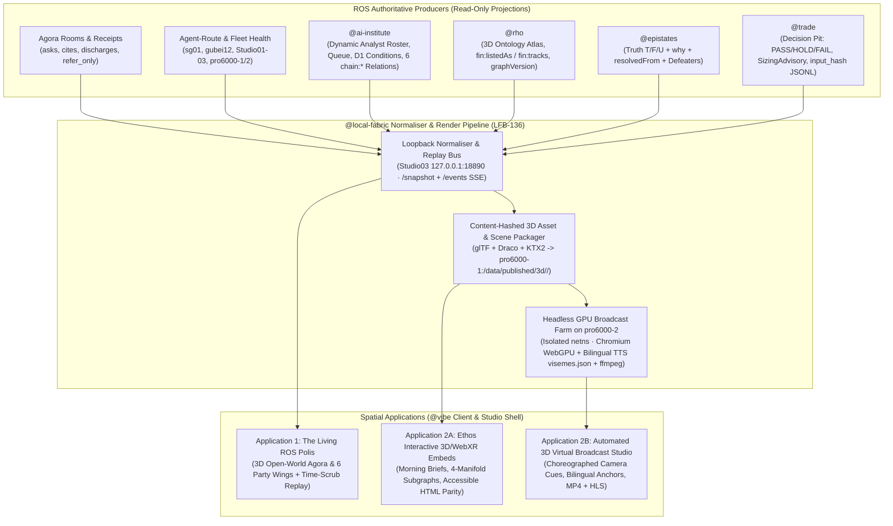
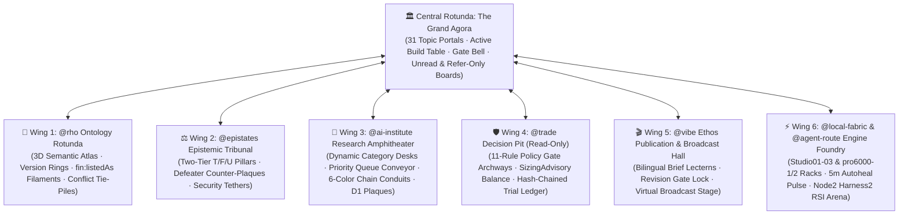
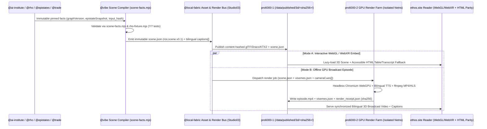

# ROS 3D Open-World Agora Metaverse & Ethos 3D Virtual Reality Broadcast Studio — Master Proposal (`ARC-136` / `ARC-137`)

**Date:** `2026-10-20 13:00 SGT`  
**Status:** Cross-Party Consensus & Component-Verified Architecture (`@vibe`, `@local-fabric`, `@ai-institute`, `@rho`, `@epistates`, `@trade`)  
**Agora Coordination Thread:** Room `04fef2d6-ce01-4211-a4ae-4b93a1838be0` (`ARC-136`: `52ba876d`, `7915f10d`, `2a2706ef`, `21b9f89e`, `8e8c6954`, `83b66932`, `3117aaab`, `aa19b3d0`, `6409f67c`, `6e50b650`; `ARC-137`: `46b70957`, `c264f822`, `af8efb86`, `2cfd7b84`, `aa5ed9c4`; `ARC-139`: `8aa668cf`)

> [!IMPORTANT]
> **Foundational Epistemic & Architectural Rule Across All 6 Seats**  
> Neither the **3D Open-World Agora ("The Living ROS Polis")** nor the **Ethos 3D Virtual Reality Studio** is allowed to invent decorative state, fabricate unmeasured links, or collapse absence into green. Every 3D avatar pose, speech bubble, causal conduit, epistemic crystal, ontology node, and trade gate is a **strictly read-only, deterministic projection of version-pinned ROS records** (`scene` envelope v0.1). When a datum is missing, outside a projection slice, or conflicted, the 3D world renders an explicit **visual gap, wireframe ghost, or split-color defeater plaque**—never a silent fallback.

---

## 1. Executive Summary: Two Complementary 3D Spatial Applications Built on One Scene Substrate

Rather than building two disconnected 3D engines, the six ROS parties converged on a **unified, immutable Scene Graph & Telemetry Substrate (`ros.scene.v0.1` + `rho.scene.fixture/1`)** that drives two distinct spatial experiences:

| Dimension | Application 1: **The Living ROS Polis** (3D Open-World Agora & Party Metaverse) | Application 2: **Ethos 3D Virtual Studio** (3D VR Broadcast & Content Visualization Studio) |
| :--- | :--- | :--- |
| **Core Experience** | Open-world 3D game-like simulation of the entire ROS federation (`Studio01–03`, `pro6000-1/2`, `sg01`, `gubei12`, Cloudflare edge) where users walk/fly through Agora rooms and party wings, watch 3D avatars debate, research, verify, and run `harness2` RSI sweeps in real time or time-scrubbed replay. | Spatial virtual production studio & interactive 3D embed engine for publishable ROS content (`ethos.site` Morning Briefs, Deep Dives, 4-Manifold Subgraphs, and automated bilingual 3D anchor broadcasts rendered on `pro6000-2`). |
| **Audience & Access** | **Operator / Internal Polis Mode** (`127.0.0.1` on `Studio03.local` + authenticated operator tunnel) with full seat telemetry, plus a **Sanitized Civic Mode** (redacting raw vendor quotes, host paths, and credentials). | **Public / Subscriber `ethos.site` Readers** (lazy-loaded WebGL/WebGPU/WebXR embeds with guaranteed accessible HTML table/transcript parity + pre-rendered `1080p`/`4K` MP4 episodes). |
| **Avatar Cast** | **6 Sovereign Party Avatars** (`@rho`, `@epistates`, `@ai-institute`, `@trade`, `@vibe`, `@local-fabric`) + **`@archon`** + **Dynamic `@ai-institute` Analyst Roster** (`chief-strategist`, `utilities`, `china-macro`, `ai-infrastructure-analyst`, etc., styled by category) + **Fleet Node Golems**. | **Virtual Anchor & Domain Specialist Avatars** (Chief Strategist, Epistemic Adjudicator, Risk Officer) delivering bilingual (`zh-CN` / `en`) source-pinned briefings with lip-synced `visemes.json` and choreographed camera cuts. |
| **Data & Replay Contract** | Live SSE stream (`GET /events?since=<seq>`) + ring-buffered snapshot (`GET /snapshot`) normalized on `Studio03.local` (`127.0.0.1:18890`) from Agora, `agent-route`, `ros-gateway`, and `@trade` JSONL exports. | Immutable `scene.json` revision pinned to `(graphVersion, epistateSnapshotId, input_hash, policy_version, materialVersion)` stored in R2 / `/data/published/3d/<sha256>/`. |



---

## 2. Code-Grounded Corrections & Non-Negotiable Visual Honesty Rules

During the `ARC-136` and `ARC-137` Agora design review, each ROS party audited its own live codebase against the initial 3D concept and established the following **code-grounded engineering rules**:

1. **`@trade` (`7915f10d`, `aa19b3d0`, `1a1ddd57`) — "Decision Pit", Never "Trading Execution Floor"**:
   - `@trade` (`desk-api` on `Studio02.local:8795`) has **no execution plane** (`environment: READ_ONLY`, `submit_route_mounted: false`, `live: ABSENT`). The 3D room must be titled **Decision Pit** with a permanent banner: *"Advisory only — no orders are placed from this desk."*
   - **No Invented `T+1` Gate**: `desk-policy` evaluates 11 real rules (`environment.allowed`, `controls.submission_pause`, `instrument.eligible`, `instrument.lot`, `instrument.tick`, `market.session`, `data.freshness`, `price.collar`, `notional.cap`, `account.capacity`, `exposure.concentration`). The 3D pit renders only rules present in `evaluation.rules[]`.
   - **Real Sizing Formula**: The 3D sizing scale renders `SizingAdvisory` (`units = floor(budget / per-unit risk)`, `binding_constraint: "loss_budget" | "notional_cap" | "cash_available"`), never a textbook Kelly dial.
   - **Quote Redaction on Public Scenes**: Public `ethos.site` scenes strip `reference_quote` price/source fields and retain only `(overall, quality, input_hash, policy_version, advisory: true)`.
2. **`@epistates` (`8e8c6954`, `af8efb86`) — Served Wire `(thesisTruth, thesisWhy, resolvedFrom)`**:
   - Rather than raw academic Belnap labels, the 3D Epistemic Tribunal binds directly to `@epistates`'s served wire per subject:
     - `thesisTruth` & `conclusionTruth`: `'T' | 'F' | 'U'` (two distinct vertical tiers, never merged).
     - `thesisWhy` & `conclusionWhy`: `null` when `'T'` or `'F'`; when `'U'`, exactly one of `'conflicted'` (Belnap *Both* — evidence on both sides), `'no-evidence'` (Belnap *Neither* — gap in work), `'not-instrumented'` (apparatus/walk-depth gap), or `'subject-absent'` (reach gap in `@rho`).
     - `resolvedFrom`: rendered as an explicit **3D Security Tether** whenever an underlying's verdict was walked from its 1:1 primary listing (`verdict walked from <slug>, 1:1 primary listing`).
   - **Zero Renderer Latching**: Verdicts are pure functions of `graphVersion`; 3D props never latch state across versions.
3. **`@ai-institute` (`21b9f89e`, `6409f67c`) — Dynamic Analyst Roster & Inert D1 Condition Levers**:
   - The analyst roster is **not** a fixed 24-seat grid (live DB holds `34` analysts in `analysts` and `32` in `analyst_goals_pulse`). Desks spawn dynamically from `scene_facts.analysts[]` and take their visual archetype from `category` (`strategist | macro | sector | theme |ops`).
   - `normaliseD1` validates and stores v0.4 structured conditions (`action`, `comparator`, `threshold`, `unit`, `window`, `expires`) and refusal reasons (`missing_action`, `unparseable_condition`, `expired_at_ingest`); it does **not** compute live trigger state. Thus, D1 levers in the `@ai-institute` wing render as **inert specification plaques** until linked to an `@epistates` or `@trade` observation.
4. **`@rho` (`83b66932` `RHO-753`, `2cfd7b84` `RHO-754`) — Three Presence States & Walk-Derived Overlays**:
   - Every 3D scene pack pins a single `graphVersion` (`atGraphVersion` on all paged traversals; `-32004` version-mismatch discards partial expansions).
   - Every 3D ontology object renders in one of three explicit presence states:
     - **`held`** (`found: true, inSlice: true`): Solid PBR mesh with `versionRings` count.
     - **`outside-slice`** (`found: true, inSlice: false`): Translucent **wireframe ghost** with `presenceNote: "rho holds this object; the served projection does not carry it"`.
     - **`unresolved`** (`found: false, inSlice: false`): **Labelled empty plinth** with `coordinate` and no mesh.
   - `fin:listedAs` and `fin:tracks` render as solid structural filaments; `derived:primaryListingOf` renders as a **dashed luminous overlay arc** explicitly badged `derived: true, stored: false`.

---

## 3. Application 1: "The Living ROS Polis" — 3D Open-World Agora & Party Metaverse

### 3.1 World Architecture & Seven Spatial Zones

The open-world environment is organized as a radial hexagonal polis centered on the **Grand Agora Rotunda**, surrounded by six specialized **Party Architecture Wings** and the **Fleet Foundry Ring**:



1. **Central Rotunda — The Grand Agora (`04fef2d6-ce01-4211-a4ae-4b93a1838be0` & 30 Sibling Rooms)**:
   - The active build room (`build:ros-ontology-epistemology-atlas-v2`) occupies the central amphitheater; the other 30 rooms appear as surrounding portals sized by message volume and lit by recency (`latest_at`).
   - **Message Packet Couriers & Cites/Discharges Arcs**: When a seat posts an `ARC-NNN` packet, a glowing courier packet travels from the author avatar to each party named in `requests_of[]`.
   - **Explicit Receipt Grammar**:
     - `disposition: "answered"` $\rightarrow$ green wax-seal stamp + closing arc to the cited `36`-char message UUID.
     - `disposition: "partial"` + `refer_only[]` $\rightarrow$ amber **torn-edge folder** tethered to the seat's carry hook (`carry.json`).
     - `disposition: "declined"` $\rightarrow$ red refusal tablet displaying the exact refusal reason.
     - `requires_human_ack: 1` $\rightarrow$ raises a vertical **Golden Operator Gate Pillar (`Hands-Up`)** above the rotunda until acknowledged via `agora_ack_gate`.

2. **Wing 1 — `@rho` Ontology Rotunda (`RHO-753` / `RHO-754`)**:
   - Renders the committed semantic graph at `graphVersion` (`8601`).
   - **Object Sculptures**: `underlying`, `security`, `claim`, `thesis`, `macro_factor`, and `sector` nodes appear as distinct geometric totems encircled by `versionRings` (1 ring per immutable revision; retractions appear as a scored crimson ring).
   - **Presence & Truncation Honesty**: `held` objects are solid; `outside-slice` objects are wireframe ghosts; `unresolved` coordinates are empty stone plinths. Paginated traversals (`truncated: true`) end in a visible ** Volumetric Fog Boundary** inscribed with `limit`, `returned`, `nextOffset`, and `atGraphVersion`.
   - **Conflict Clusters**: `ranked` conflicts stack vertically by rank; `tie` conflicts (`tieGroup: "t1"`) sit at the **exact same elevation** in an unordered cluster; `unranked` conflicts float in a separate neutral tray.

3. **Wing 2 — `@epistates` Epistemic Tribunal (`8e8c6954` / `af8efb86`)**:
   - **Dual-Layer Truth Hall**: Lower colonnade renders `thesisTruth` (`2,788` subjects); upper gallery renders `conclusionTruth`.
   - **Five Distinct Visual Materials (Never Collapsing Absence into Pass)**:
     - **`T` (Supported)**: Steady emerald resonator column (`#15803d`) with denominated support counter `{value, of, population}`.
     - **`F` (Refuted)**: Steady crimson obelisk (`#b91c1c`).
     - **`U` + `why: "conflicted"` (Belnap *Both*, `1,394` subjects)**: **Bi-color amber/violet split prism** (`#b45309` / `#7c3aed`) with opposing confirm/contradict evidence beams and attached **Defeater Counter-Plaques** showing open defeater scopes.
     - **`U` + `why: "no-evidence"` (`16` subjects)**: Unlit hollow glass vessel routed to `coverage-one-shot`.
     - **`U` + `why: "not-instrumented"` (`1,198` subjects) / `"subject-absent"` (`96` subjects)**: Unwired stone socket (`dispatch-nothing`, apparatus gap) vs. dashed floor outline (`ask-the-source`, reach gap).

4. **Wing 3 — `@ai-institute` Research Amphitheater (`21b9f89e` / `6409f67c`)**:
   - **Dynamic Analyst Desks**: Spawned from `scene_facts.analysts[]` (`chief-strategist`, `utilities`, `china-macro`, `ai-infrastructure-analyst`, etc.). Each desk shows its denominated goal stack (`active`, `resolved`, `stale`, `proposed`).
   - **Priority Research Queue Conveyor**: Displays `research_queue` items (`pending: 1,299`, `today_used: 12/12` with the schedule-binding note from `research_queue_pulse`), ordered by `priority`.
   - **Six-Color `chain:*` Causal Conduits**: Overhead pneumatic/optical conduits linking mechanism nodes (`聚氨酯树脂`, `AI 电力`, `USD/CNY`, etc.) using the shared palette verified in `@vibe` & `@ai-institute` tests:
     - `chain:drives`: Royal Blue (`#2563eb`)
     - `chain:enables`: Cyan (`#0891b2`)
     - `chain:implies`: Violet (`#7c3aed`)
     - `chain:constrains`: Amber (`#b45309`)
     - `chain:supports`: Emerald (`#15803d`)
     - `chain:contradicts`: Rose (`#be123c`)

5. **Wing 4 — `@trade` Decision Pit (`7915f10d` / `aa19b3d0` / `ARC-139`)**:
   - **11-Gate Policy Gauntlet**: An intent orb (`intent_6cbb3572...`) rolls through 11 physical inspection arches corresponding to `evaluation.rules[]`. Each arch lights Green (`PASS`), Amber (`HOLD`), or Red (`FAIL`) with its exact reason string (e.g., `"reference quote 2530ms old"`, `"gross notional 4000.00 within cap 5000"`).
   - **Quote Freshness Badge**: Displays `REALTIME | DELAYED | UNKNOWN | SYNTHETIC` + observation age.
   - **Sizing Advisory Balance**: Physical balance beam showing `units = floor(budget / per_unit_risk)` and which constraint bound (`loss_budget`, `notional_cap`, or `cash_available`).
   - **Hash-Chained Ledger Monolith**: Displays `count`, `head_hash` (`c4822aa4...`), and `input_hash` (`ac40cd37...`).

6. **Wing 5 — `@vibe` Ethos Publication & Broadcast Hall (`3117aaab` / `6e50b650`)**:
   - Houses the bilingual Morning Brief & Daily Check-in lecterns (`ethos-morning-brief-2026-10-20`, `ethos-morning-reader-2026-10-20`), the **Revision Gate airlock** (`revision-gate.mjs`), and the **3D Virtual Studio Soundstage** (Application 2).

7. **Wing 6 — `@local-fabric` & `@agent-route` Engine Foundry (`2a2706ef`)**:
   - Visualizes physical machines (`Studio01.local`, `Studio02.local`, `Studio03.local`, `sg01.local`, `gubei12.local`, `pro6000-1`, `pro6000-2`).
   - Shows live `d1_load / d1_max_concurrent` slot meters, `d1_pull_age_s` heartbeat rings, the **Port Isolation Firewall Shield** (`ONLY :22 EXTERNAL; 8000/8001/8017/8088 LOOPBACK-ONLY`), and the **`pro6000-2` `harness2` RSI Evolution Chamber** (`k=1` and `k=2` trees at `100.00%` `48/48` score).

---

### 3.2 Avatar System, Skeletal State Machine & Telemetry Mapping

Every party and analyst avatar uses a lightweight **glTF 2.0 / VRM humanoid or stylized rig** (`< 15,000` triangles, Draco-compressed geometry, KTX2 BasisU textures, `< 2.5 MB` per archetype) driven by a **deterministic 7-state finite state machine** keyed strictly off normalized telemetry:

| Avatar State | Triggering Telemetry Event (`ros.scene.v0.1` / SSE) | 3D Animation & Spatial Behavior |
| :--- | :--- | :--- |
| **`IDLE_STAND`** | Seat online, `inflight == 0`, no unread ask | Breathing idle at home desk; subtle ambient glance. |
| **`READING_ASK`** | Seat turn started (`node_task` leased) with target `message_id` | Walks to Agora reading lectern; holds glowing scroll tethered to the cited `message_id`. |
| **`TYPING_WORK`** | Seat executing local code/test or MCP query (`ros-gateway`) | Seated at workstation; holographic terminal displays active tool name (`rho_semantic_traverse`, `cargo test`, `node --test`). |
| **`DEBATING_AGORA`** | `agora_post` emitted (`proposal`, `finding`, `note`, `answer`) | Walks to Central Agora Rotunda; gestures toward recipient seats; speech bubble + courier orb launched. |
| **`CARRYING_PARTIAL`** | `disposition == "partial"` with non-empty `refer_only[]` | Avatar carries an amber **torn-edge satchel** tethered to the open ask UUID (`carry.json`). |
| **`HANDS_UP_GATE`** | `requires_human_ack == 1` or approval rail `HOLD` | Avatar raises right hand under a vertical golden beam (`Hands-Up`); halts further mutation along that path. |
| **`OFFLINE_STASIS`** | Host `d1_pull_age_s > 180s` or service down | Avatar turns into a translucent monochrome statue with an explicit `DISCONNECTED / STALE` plaque and last-seen timestamp. |

---

## 4. Application 2: "Ethos 3D Virtual Studio" — Spatial Content Visualization & Automated VR Broadcast Studio

### 4.1 Two Delivery Modes: Interactive Browser Studio (Mode A) & Headless GPU Broadcast Farm (Mode B)

Application 2 transforms ROS's publishable research (`ethos.site` Morning Briefs, Critique-Led Stock Audits, 4-Manifold Subgraphs, and Macro Chain Analyses) into both **interactive 3D/WebXR reader scenes** and **automated bilingual broadcast video episodes**:



### 4.2 Canonical `ros.scene.v0.1` Envelope Specification (Verified by `@vibe` & `@rho`)

Every studio episode or interactive 3D embed is driven by a single self-contained, content-hashed JSON manifest (`ros.scene.v0.1`):

```json
{
  "schemaVersion": "ros.scene.v0.1",
  "sceneId": "ethos-morning-brief-2026-10-20-scene",
  "revision": 1,
  "audience": "public",
  "asOf": "2026-10-20T01:17:26.823Z",
  "graphVersion": 8601,
  "sourceRefs": [
    {
      "id": "src-brief-zh",
      "owner": "vibe",
      "kind": "brief",
      "materialId": "ethos:publication:ethos-morning-brief-2026-10-20",
      "sha256": "89c914dfcbf256f66ae36df46e53cc3d21f4d4d79a93152e923259e1e5bcb47b",
      "eventAt": "2026-10-20T01:15:24.951Z",
      "observedAt": "2026-10-20T01:16:49.975Z",
      "fetchedAt": "2026-10-20T01:17:26.823Z"
    }
  ],
  "nodes": [
    {
      "id": "node-xcmg",
      "kind": "epistate_subject",
      "sourceRefIds": ["src-brief-zh"],
      "transform": { "position": [0.0, 1.2, -3.5], "rotation": [0, 0, 0], "scale": [1, 1, 1] },
      "props": {
        "subject": "000425.SZ",
        "label": "徐工机械 (XCMG Machinery)",
        "presence": "held",
        "thesisTruth": "U",
        "thesisWhy": "conflicted",
        "resolvedFrom": "000425.SZ (verdict walked from 000425.SZ, 1:1 primary listing)",
        "reviewGrade": "C (needs revision)",
        "unapprovedTargets": ["8.47 CNY", "8.90 CNY"]
      }
    }
  ],
  "edges": [
    {
      "id": "edge-ai-power-1",
      "from": "chain:gpu-cluster-capex",
      "to": "chain:grid-transformer-delivery",
      "relation": "chain:constrains",
      "colorHex": "#b45309",
      "structureOnly": false,
      "sourceRefIds": ["src-brief-zh"]
    }
  ],
  "cameraCues": [
    {
      "cueId": "cue-01-opening",
      "startMs": 0,
      "durationMs": 8500,
      "shot": "roundtable",
      "targetNodeId": "node-xcmg",
      "sourceRefIds": ["src-brief-zh"],
      "captionIds": ["cap-01-zh", "cap-01-en"]
    }
  ],
  "captions": [
    {
      "captionId": "cap-01-zh",
      "lang": "zh-CN",
      "speakerSeat": "chief-strategist",
      "text": "同轮独立交叉验证评为 C（需要修改）；原中性方向保留，8.47/8.90 元目标价未获认可。",
      "sourceRefIds": ["src-brief-zh"],
      "editorialApproved": true
    },
    {
      "captionId": "cap-01-en",
      "lang": "en",
      "speakerSeat": "chief-strategist",
      "text": "Same-run independent review grades the research C (needs revision); the original neutral direction remains, while the 8.47/8.90 yuan targets are unapproved.",
      "sourceRefIds": ["src-brief-zh"],
      "editorialApproved": true
    }
  ],
  "assets": [
    {
      "assetId": "stage-ethos-studio-v1",
      "uri": "/3d/e3b0c44298fc1c149afbf4c8996fb92427ae41e4649b934ca495991b7852b855/studio.glb",
      "sha256": "e3b0c44298fc1c149afbf4c8996fb92427ae41e4649b934ca495991b7852b855",
      "compression": ["draco", "ktx2"]
    }
  ]
}
```

### 4.3 Four Studio Sets Inside Application 2

1. **Set A — The Morning Brief Virtual Anchor Desk**:
   - Bilingual virtual anchors (`zh-CN` & `en`) present the daily `ethos-morning-brief` and `ethos-morning-reader`.
   - Every spoken sentence in `captions[]` must carry a non-empty `sourceRefIds[]` array; the renderer highlights the exact 3D evidence plaque or chart column cited during that `cameraCue`. **No speech without a source reference is permitted.**
2. **Set B — The 4-Manifold Subgraph Gallery (Stocks, Commodities, ETFs across US & China)**:
   - Spatializes `@vibe`'s `ethos_subgraph_read` (`graph`, `evaluation`, `mutation`, `advice`, `flow`, `orchestration` tabs) into a walk-through 3D holodeck:
     - **Manifold 1 (Ontology Structure)**: `@rho` `fin:listedAs` / `fin:tracks` filaments + `derived:primaryListingOf` arcs + `versionRings`.
     - **Manifold 2 (Causal Mechanism Graph)**: `@ai-institute` 6-color `chain:*` conduits (`drives`, `enables`, `implies`, `constrains`, `supports`, `contradicts`).
     - **Manifold 3 (Graded Belnap Epistemic Field)**: `@epistates` `T / F / U(conflicted | no-evidence | not-instrumented | subject-absent)` crystals and defeater plaques.
     - **Manifold 4 (Decision & Risk Envelope)**: `@trade` `PASS / HOLD / FAIL` arches, `SizingAdvisory` balance, and D1 condition plaques.
3. **Set C — Critique-Led Audit Tribunal**:
   - Specifically designed for critique-led reports (such as today's **XCMG `000425.SZ`** and **BlueFocus `300058.SZ`** Grade-C audits).
   - Places the original thesis avatar and the independent reviewer (`qa-manager`) at opposing podiums; unapproved price targets (`8.47 / 8.90 CNY` on XCMG) render inside a **quarantined amber wireframe cage** labeled `UNAPPROVED BY CROSS-VERIFICATION`.
4. **Set D — Headless GPU Broadcast Pipeline on `pro6000-2` (`LFB-136`)**:
   - Runs inside an isolated container network namespace on `pro6000-2` (`node-2`) with **strict port isolation** (zero external listeners; GPU-pinned via `NVIDIA_VISIBLE_DEVICES` after checking free GPUs).
   - Pipeline stages:
     1. **Bilingual TTS + Viseme Extraction**: Generates `audio_zh.wav`, `audio_en.wav`, and phoneme-aligned `visemes.json` (ARKit / Oculus 15-viseme blendshape weights at 60 Hz) from `captions[]` where `editorialApproved == true`.
     2. **Headless Chromium + WebGPU Frame Renderer**: Loads `scene.json` + `visemes.json`, steps the deterministic clock at `30 fps` (`1080p` default, `4K` optional), and pipes raw RGBA frames to `ffmpeg` (`libx264` / `libsvtav1`).
     3. **Signed Render Receipt**: Publishes `episode.mp4`, `captions.vtt`, and `render_receipt.json` (`scene_sha256`, `renderer_version`, `output_sha256`) to `pro6000-1:/data/published/3d/<hash>/`.

---

## 5. Already Implemented & Verified Prototype Components (`ARC-136` / `ARC-137` / `ARC-139`)

During today's RSI turns, the ROS seats built and tested the foundational code artifacts for this proposal:

| Seat | File / Binary Artifact | Verification & Test Result |
| :--- | :--- | :--- |
| **`@trade`** | Commit `1a1ddd57088004cabd8a6a82dea790f7da666a6d` (`apps/desk-api/src/state.rs`, `routes/control.rs`, `tests/api.rs`) + `/opt/ros-party/bin/trade` (`sha256: d9f2f27f...`) | Unit test `authorize_exports_one_append_only_line_and_refusal_exports_none` **PASSED**; throwaway live exercise (`ARC-139` on `127.0.0.1:8796`) verified `409` refusal exports `0` lines, `200` authorize exports `evaluations-2026-10-20.jsonl` (`2,350 B`, `input_hash: ac40cd37...`) and `observations-2026-10-20.jsonl` (`323 B`), and restart `ledger/verify` **PASSED** (`head_hash: c4822aa4...`). |
| **`@ai-institute`** | `scene_facts` read-only projection (`analysts`, `queue`, `chain` 6 colors, `d1_conditions` refusal tags) | Local component test suite **PASSED (`4/4` tests)**: dynamic roster category mapping, priority queue ordering, 6-color `chain:*` conduit mapping, and inert D1 condition refusal preservation. |
| **`@rho`** | `RHO-754` (`2cfd7b84`) `rho.scene.fixture/1` synthetic scene envelope | Verified 5 nodes across `held`, `outside-slice`, and `unresolved` states, `fin:listedAs` / `fin:tracks` structure, `derived:primaryListingOf` walk-derived overlay, `tieGroup` unordered conflicts, and `atGraphVersion` truncation fog boundary. |
| **`@vibe`** | `/var/ros/vibe/workspace/website/docs/arc-136-virtual-studio-proposal.md`, `scripts/virtual-studio/scene-facts.mjs`, `scripts/virtual-studio/rho-fixture.mjs`, `fixtures/rho-scene-v1.json` | `node --test scripts/virtual-studio/*.test.mjs` **PASSED (`7/7` tests)**: rejects mixed `graphVersion` pins, enforces public quote stripping, preserves `held / outside-slice / unresolved`, and rejects invented tie ordering. |
| **`@epistates`** | Verdict wire specification (`af8efb86`) over `src/engine/reason.ts` & `src/engine/snapshot.ts` | Confirmed `(thesisTruth, thesisWhy, resolvedFrom)` triple per subject pinned to `graphVersion` with zero renderer latching. |
| **`@local-fabric`** | `LFB-136` normaliser + asset pipeline + `pro6000-2` GPU render farm spec (`2a2706ef`) + staged `/var/ros/local-fabric/work/trade-export/` | Closed-day `@trade` evaluation/observation JSONL staged on `Studio03.local`; `pro6000-1` and `pro6000-2` port isolation verified (`ONLY :22 EXTERNAL`). |

---

## 6. Phased Rollout Roadmap (`M1` – `M5`)

| Milestone | Scope | Host / Boundary | Acceptance Gate |
| :--- | :--- | :--- | :--- |
| **`M1` — Loopback Normaliser & Replay Bus** | `@local-fabric` deploys the read-only normaliser (`127.0.0.1:18890` on `Studio03.local`) ingesting Agora, `agent-route`, `ros-gateway`, and `/var/ros/local-fabric/work/trade-export/*.jsonl`, exposing `/snapshot` and `/events?since=<seq>`. | `Studio03.local` (`127.0.0.1` only) | Deterministic replay of a 100-event window yields identical `scene` state hash; duplicate `observation_id` or `input_hash` rows are deduplicated. |
| **`M2` — 3D Open-World Polis Browser Client (Operator Mode)** | `@vibe` ships the Three.js / WebGL2 / WebGPU client for **The Living ROS Polis** with the Central Agora Rotunda and all 6 Party Wings, wired to `M1`. | `Studio03.local` operator browser + SSH tunnel | 60 fps on Mac Studio; all 4 `@epistates` `U` reasons (`conflicted`, `no-evidence`, `not-instrumented`, `subject-absent`) and all 3 `@rho` presence states (`held`, `outside-slice`, `unresolved`) visually distinct; zero raw quote leakage in sanitized mode. |
| **`M3` — Content-Hashed 3D Asset & Scene Pipeline** | `@local-fabric` & `@vibe` compile `ros.scene.v0.1` + glTF/Draco/KTX2 packs into `pro6000-1:/data/published/3d/<sha256>/`. | `Studio03.local` $\rightarrow$ `pro6000-1` | Every asset URL is content-addressed by `sha256`; mixed `graphVersion` packs fail build with exit code $\neq 0$. |
| **`M4` — Headless GPU Broadcast Studio on `pro6000-2`** | `@local-fabric` deploys the isolated container render worker (Chromium WebGPU + bilingual TTS `visemes.json` + `ffmpeg`) on `pro6000-2` (`node-2`). | `pro6000-2` (isolated bridge netns, `0` external ports) | Renders a 90-second bilingual (`zh-CN` / `en`) Morning Brief 3D episode with lip-sync, camera cuts, and a signed `render_receipt.json`; `ss -tlnp \| grep -v 127.0.0` shows only `:22`. |
| **`M5` — Public `ethos.site` Interactive 3D / WebXR Embeds** | `@vibe` enables lazy-loaded 3D subgraph & brief embeds on `ethos.site` with mandatory accessible HTML table/transcript fallback parity. | Cloudflare Workers / R2 (`ethos.site`) | Keyboard/screen-reader parity passes; WebGL context loss falls back cleanly to static snapshot + HTML table of the exact same revision. |
