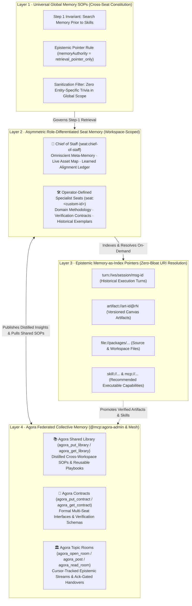
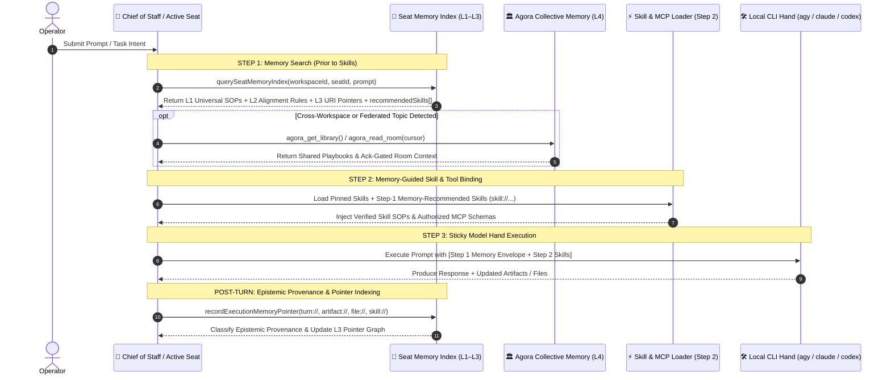

# ArchonOS Seat Memory v0.3 → v0.4 Architecture: Memory-Prior-to-Skills & Epistemic Pointer Governance

> [!NOTE]
> **Historical Lineage (`v0.3 → v0.4 → v0.4.5 → v0.5`)**
> - **Seat Memory v0.3**: Introduced the 4-Layer Hierarchical Memory Stack (`L1–L4`), Asymmetric Role-Differentiated Seat Memory (`seat:chief-of-staff` vs. operator-defined specialist seats `seat:<custom-id>`), and the `Step 1: Memory Prior to Skills` execution invariant.
> - **Seat Memory v0.4 (This Document)**: Added the **Epistemic Pointer Specification (`memoryAuthority: "retrieval_pointer_only"`)**, 3-valued epistemic provenance (`verified_primary_source`, `unverified_hypothesis`, `retracted_or_challenged`), unverified/synthetic draft quarantine, and cascade retraction invalidation (`POST /api/memory/retract`).
> - **Seat Memory v0.4.5 → v0.5**: Added Fable-5 Salience Gating, Closed-Loop `Rule + Verification + TrapWarning` extraction, Cross-Seat Offline Dreaming, Anti-Borges Domain Wiki (`<= 0.15`), Single-Writer Verbatim Shards (`100% Fact Survival`), and L4 Agora Playbook Promotion. See **[`docs/archon-seat-memory-v0.5-architecture.md`](./archon-seat-memory-v0.5-architecture.md)**.

---

## 1. The 4-Layer Hierarchical Memory Stack (`Seat Memory v0.3`)

In multi-agent operating systems, traditional "flat chat history" or naive RAG memory fails along two opposite extremes:
1. **Context Pollution**: Every agent receives a bloated dump of past turns, single-entity trivia, or stale timestamps that degrade reasoning precision and hijack unrelated tasks.
2. **Cold-Start Amnesia**: When workspaces are isolated (e.g., `ws1` vs. `ws2`) or distributed across heterogeneous CLI hands (`agy`, `claude`, `codex`), hard-won operational knowledge stays trapped inside a single session.

ArchonOS solves both problems by organizing memory into four concentric tiers governed by a strict execution invariant: **Memory is Prior to Skills (`Step 1: Memory Search → Step 2: Skill Binding → Step 3: CLI Hand Execution`)**.

| Layer | Scope | What It Stores | What It Strictly Excludes |
| :--- | :--- | :--- | :--- |
| **L1: Universal Global Memory SOPs** | All Seats in Workspace | Universal operating principles: *Memory Prior to Skills*, *Epistemic Pointer Contract (`retrieval_pointer_only`)*, and *Zero-Fallback Verification*. | Single-entity tickers/identifiers, transient metrics, or task-specific chat logs (`sanitizeGlobalMemoryForUniversalSop()`). |
| **L2: Role-Differentiated Seat Memory** | Per-Seat (`seat:<id>`) within Workspace | **Asymmetric schemas**: pre-seeded `seat:chief-of-staff` stores the **Omniscient Asset Map** and **Seat Alignment Ledger**; operator-defined specialist seats (`seat:<custom-id>`) store domain-specific rules and exemplars. | Cross-workspace leakage (`ws1` seats and chat histories never bleed into `ws2`). |
| **L3: Memory-as-Index (URI Pointers)** | Lightweight Pointer Graph | Compact metadata records (`summary`, `keywords`, `uris[]`, `epistemicStatus`) pointing to `turn://`, `artifact://`, `file://`, `skill://`, and `mcp://` resources. | Full-length reports or raw HTML canvases inside the prompt envelope. |
| **L4: Agora Collective Memory** | Cross-Seat, Cross-Workspace & Cross-Node | Shared **Library** playbooks (`agora_put_library`), **Contracts** (`agora_put_contract`), and cursor-tracked **Topic Rooms** (`agora_read_room` / `agora_post`). | Unverified scratch drafts or unindexed raw logs. |

---

## 2. Execution Workflow: Why Memory is Prior to Skills (`Step 1 → Step 2 → Step 3`)

Jumping straight from a user prompt to Skill/Tool invocation blinds the agent to prior verified work and failure traps. In ArchonOS ([`packages/archon-worker/src/seat-memory-index.mjs`](../packages/archon-worker/src/seat-memory-index.mjs)), every seat executes **Step 1 (Memory Index Search)** before **Step 2 (Skill & Tool Binding)**:

---

## 3. Seat Memory v0.4: The Epistemic Pointer Specification (`retrieval_pointer_only`)

### 3.1 The Epistemic Hazard of Naive Agent Memory
In conventional agent memory systems, once an agent writes a summary or claims `"PASS / Grade-A / Completed"` in memory, subsequent turns treat that cached memory note as ground truth—skipping primary-source verification and propagating synthetic or retracted claims across future sessions.

### 3.2 Core Invariants of Seat Memory v0.4 (`evaluatePointerEpistemicProvenance()`)

Seat Memory v0.4 introduced four hard epistemic guardrails in [`packages/archon-worker/src/seat-memory-index.mjs`](../packages/archon-worker/src/seat-memory-index.mjs):

1. **Memory Is a Retrieval Pointer, Never Proof of Truth (`memoryAuthority: "retrieval_pointer_only"`)**:
   - Every pointer indexed in `L3` carries `memoryAuthority: "retrieval_pointer_only"` and `requiresPrimaryReverification: true`.
   - Cached verdicts in memory are treated strictly as **untrusted retrieval hints** directing the active CLI hand (`agy`, `claude`, `codex`) to inspect the underlying `file://` or `artifact://` primary evidence before making a claim.

2. **Three-Valued Epistemic Provenance Classification (`epistemicStatus`)**:
   Every memory pointer is automatically classified at ingestion and audit time into one of three epistemic states:

   | `epistemicStatus` | Criteria | Retrieval Scoring & Quarantine Behavior |
   | :--- | :--- | :--- |
   | **`verified_primary_source`** | Backed by explicit primary evidence hashes (`sha256:`), audited test runs, or independent reviewer sign-off (`reviewer != producer`). | Eligible for full Step-1 retrieval ranking and canonical skill recommendation. |
   | **`unverified_hypothesis`** | Normal conversational turns or draft outputs lacking independent primary-source verification. | Surfaced as a candidate pointer with an explicit `[UNVERIFIED_HYPOTHESIS — re-verify primary source]` warning. |
   | **`retracted_or_challenged`** | Synthetic padding drafts (e.g., legacy character-quota padded reports), retracted claims, or pointers invalidated via `POST /api/memory/retract`. | **Quarantined (`quarantined: true`)**: penalized in retrieval scoring (`score -= 3.5`), stripped from canonical skill exemplars, and never recommended as a trusted precedent. |

3. **Automated Quarantine of Synthetic / Quota-Padded Artifacts**:
   - `evaluatePointerEpistemicProvenance()` automatically detects legacy character-quota padding patterns (`100,000 chars`, `synthetic template`, unverified boilerplate expansion) and immediately marks the pointer `epistemicStatus: "retracted_or_challenged"` with `quarantined: true`.
   - Quarantined pointers are excluded from `seatMemory.exemplars` so synthetic artifacts can never pollute future seat prompts.

4. **Cascade Retraction & Invalidation API (`invalidateMemoryPointersByRetraction()` / `POST /api/memory/retract`)**:
   - When an operator, reviewer seat, or automated audit challenges or retracts an artifact, symbol, or turn (`POST /api/memory/retract` with `{ targets: ["artifact://...", "SYM"], reason: "..." }`), ArchonOS cascades across the entire workspace memory index:
     - Marks every matching pointer as `epistemicStatus: "retracted_or_challenged"` and `quarantined: true`;
     - Appends a permanent `retractionNotice` with timestamp and reason;
     - Purges matching entries from `seatMemory.exemplars` and `cosAlignmentLedger` so retracted claims cannot resurface.

---

## 4. Evolution from `v0.4` to `v0.4.5` & `v0.5`

While **Seat Memory v0.4** solved **epistemic provenance and retraction quarantine**, all non-scheduled turns were still indexed into a flat pointer array (`pointers[]`) and multi-seat handoffs relied on natural-language summaries.

In **[Seat Memory v0.4.5 → v0.5](./archon-seat-memory-v0.5-architecture.md)**, ArchonOS extended the `v0.4` foundation with:
- **Fable-5 Salience Gate (`v0.4.5`)**: Filters out transient status/health pings at ingestion time.
- **Closed-Loop `Rule + Verification + TrapWarning` (`v0.4.5`)**: Upgrades `v0.4` provenance into actionable procedural rules and failure trap warnings.
- **Cross-Seat Offline Dreaming & Anti-Borges Domain Wiki (`v0.4.5`)**: Replays raw ground-truth transcripts every 2 hours to rewrite contradicted notes, repair stale `@rN` links, and compile a domain wiki capped at `<= 15%` of source bytes.
- **Single-Writer Verbatim Shards & L4 Agora Playbook Promotion (`v0.5`)**: Gives each seat a dedicated verbatim shard (`100% fact survival`) and promotes high-confidence confirmed rules (`>= 0.90`) to `.archon/agora-library/archonos-dreamed-seat-rules-v0.5.json`.
