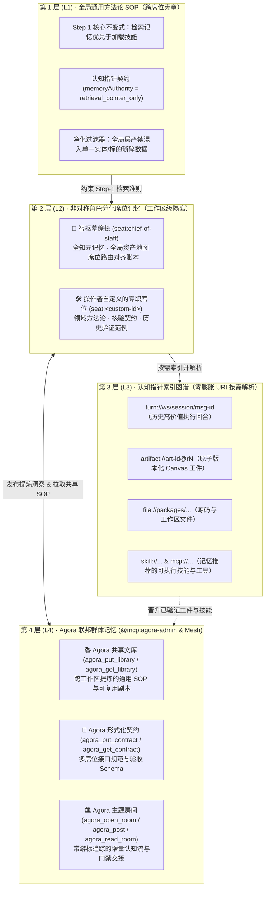
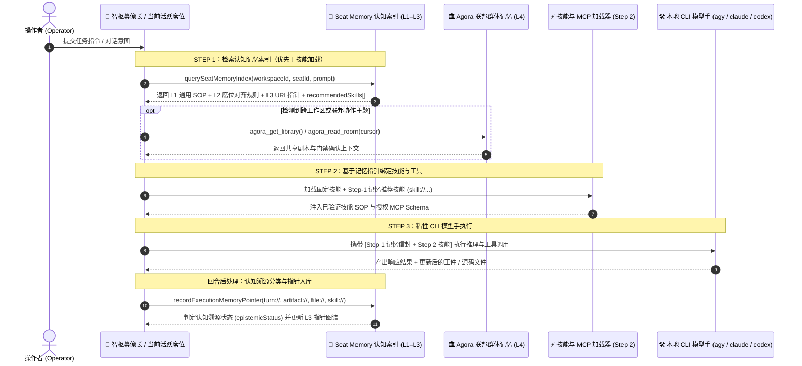

# ArchonOS Seat Memory v0.3 → v0.4 认知记忆架构：记忆优先于技能与认知指针治理规范

**[English](./archon-seat-memory-v0.4-architecture.md)** | **[简体中文](./archon-seat-memory-v0.4-architecture.zh-CN.md)**

> [!NOTE]
> **版本演进脉络 (`v0.3 → v0.4 → v0.4.5 → v0.5`)**
> - **Seat Memory v0.3**：确立了四层分级记忆架构（`L1–L4`）、非对称角色分化席位记忆（默认预置的智枢幕僚长 `seat:chief-of-staff` 与操作者按需定义的专职席位 `seat:<custom-id>`），以及 `Step 1: 记忆优先于技能（Memory Prior to Skills）` 的执行不变式。
> - **Seat Memory v0.4（本文档）**：新增**认知指针规范（`memoryAuthority: "retrieval_pointer_only"`）**、三值认知溯源分类（`verified_primary_source`、`unverified_hypothesis`、`retracted_or_challenged`）、未核验/注水合成草稿自动隔离，以及级联撤稿失效接口（`POST /api/memory/retract`）。
> - **Seat Memory v0.4.5 → v0.5**：新增 Fable-5 显著性门控、闭环 `规则 + 验证方式 + 陷阱告警` 抽取、跨席位离线梦境整合（Offline Dreaming）、反博尔赫斯领域 Wiki（压缩率 `<= 0.15`）、单写者原话分片（`100%` 事实无损存活）与 L4 Agora 联邦剧本晋升。详见 **[`docs/archon-seat-memory-v0.5-architecture.zh-CN.md`](./archon-seat-memory-v0.5-architecture.zh-CN.md)**。

---

## 1. 四层分级记忆架构 (`Seat Memory v0.3`)

在多智能体操作系统中，传统的“扁平对话历史”或朴素 RAG 记忆往往陷入两个极端：
1. **上下文污染（Context Pollution）**：每个智能体都被塞入冗长的历史对话、单一标的琐碎信息或过期时间戳，导致推理精度下降并干扰无关任务。
2. **冷启动失忆（Cold-Start Amnesia）**：当不同工作区严格隔离（如 `ws1` 与 `ws2`）或任务跨多个本地 CLI 模型手（`agy`、`claude`、`codex`）协同执行时，宝贵的实操经验与踩坑教训被困在单次会话中无法复用。

ArchonOS 通过构建**四层同心认知记忆架构**，并强制执行 **`Step 1: 记忆检索 → Step 2: 技能绑定 → Step 3: CLI 模型手执行`** 的核心不变式，同时解决了这两个问题：

| 记忆层级 | 作用域 | 存储的核心内容 | 严格剔除/禁止存储的内容 |
| :--- | :--- | :--- | :--- |
| **L1：全局通用方法论 SOP** | 工作区内全部席位 | 通用执行原则：*记忆优先于技能（Memory Prior to Skills）*、*认知指针契约（`retrieval_pointer_only`）*与*零回退实证核验*。 | 单一股票代码/实体标识符、瞬态指标或特定任务对话日志（由 `sanitizeGlobalMemoryForUniversalSop()` 自动净化）。 |
| **L2：非对称角色分化席位记忆** | 工作区内单席位（`seat:<id>`） | **非对称 Schema**：默认预置的 `seat:chief-of-staff` 存储**全知资产地图**与**席位路由对齐账本**；操作者自定义的专职席位（`seat:<custom-id>`）存储各自领域的专属规则与验证范例。 | 跨工作区串味泄露（`ws1` 的席位记忆与会话历史绝不渗入 `ws2`）。 |
| **L3：记忆即索引（URI 指针图谱）** | 轻量级指针图谱 | 紧凑元数据记录（`summary`、`keywords`、`uris[]`、`epistemicStatus`），精准指向 `turn://`、`artifact://`、`file://`、`skill://` 与 `mcp://` 资源。 | 严禁将长篇完整报告或原始 HTML 画布直接塞入提示词信封。 |
| **L4：Agora 联邦群体记忆** | 跨席位、跨工作区与跨节点 | 共享**文库（Library）**剧本（`agora_put_library`）、**契约（Contracts）**（`agora_put_contract`）与带游标追踪的**主题房间（Topic Rooms）**（`agora_read_room` / `agora_post`）。 | 未经核验的临时草稿或未建立索引的原始运行日志。 |

---

## 2. 执行工作流：为什么记忆必须优先于技能 (`Step 1 → Step 2 → Step 3`)

大多数智能体框架收到用户指令后直接跳入技能/工具调用，导致智能体无法获知：已有工件（`artifact://...@rN`）或历史回合（`turn://...`）是否已解决了核心问题、哪个专职席位与模型手（`claude`、`codex`、`agy`）在该类任务上验证通过率最高，以及过去踩过哪些陷阱。

在 ArchonOS（[`packages/archon-worker/src/seat-memory-index.mjs`](../packages/archon-worker/src/seat-memory-index.mjs)）中，每个席位在每次执行时都严格遵循 **`Step 1（记忆检索）→ Step 2（技能与工具绑定）→ Step 3（本地 CLI 模型手执行）`**：

---

## 3. Seat Memory v0.4：认知指针规范 (`retrieval_pointer_only`)

### 3.1 朴素智能体记忆的“认知污染”隐患
在传统智能体记忆系统中，一旦某次对话把结论或自评的 `"PASS / Grade-A / 已完成"` 写入记忆，后续回合就会把这段缓存摘要当成无需复核的“既定真值”，直接跳过一手证据核验，导致合成注水内容或已撤回的错误结论在后续会话中不断扩散。

### 3.2 Seat Memory v0.4 的四大核心认知护栏 (`evaluatePointerEpistemicProvenance()`)

Seat Memory v0.4 在 [`packages/archon-worker/src/seat-memory-index.mjs`](../packages/archon-worker/src/seat-memory-index.mjs) 中确立了四项内核级认知护栏：

1. **记忆仅作检索指针，绝不替代一手证据（`memoryAuthority: "retrieval_pointer_only"`）**：
   - `L3` 中的每一条记忆指针均强制标记 `memoryAuthority: "retrieval_pointer_only"` 与 `requiresPrimaryReverification: true`。
   - 记忆中缓存的历史结论仅作为**不可信的检索线索（Untrusted Retrieval Hints）**，用于指引当前 CLI 模型手（`agy`、`claude`、`codex`）定位并核验底层的 `file://` 或 `artifact://` 一手证据。

2. **三值认知溯源状态分类（`epistemicStatus`）**：
   每一条记忆指针在写入与审计时都会被自动归入以下三种认知状态之一：

   | `epistemicStatus` 状态 | 判定标准 | 检索打分与隔离行为 |
   | :--- | :--- | :--- |
   | **`verified_primary_source`（已核验一手证据）** | 具备明确的一手证据哈希（`sha256:`）、实测通过的测试套件或独立审稿席位签字（`reviewer != producer`）。 | 允许参与完整的 Step-1 检索排序与标准技能推荐。 |
   | **`unverified_hypothesis`（未核验假设）** | 普通对话回合或尚未经过独立一手证据核验的初稿产物。 | 作为候选指针返回，并在提示词信封中显式附带 `[UNVERIFIED_HYPOTHESIS — 必须复核一手证据]` 警示。 |
   | **`retracted_or_challenged`（已撤回或受质疑）** | 为凑字数而生成的模板注水草稿、已被证伪的结论，或通过 `POST /api/memory/retract` 撤回的指针。 | **强制隔离（`quarantined: true`）**：检索权重严厉扣分（`score -= 3.5`），从席位标准范例（`exemplars`）中剔除，绝不作为可信先例推荐。 |

3. **合成/凑字数注水工件的自动识别与隔离**：
   - `evaluatePointerEpistemicProvenance()` 会自动检测遗留的字数配额注水特征（如 `100,000 chars` 硬性凑字数模板、重复段落拼接或无证据支撑的合成内容），立即将其标记为 `epistemicStatus: "retracted_or_challenged"` 且 `quarantined: true`，防止合成草稿污染后续席位提示词。

4. **级联撤稿与失效 API（`invalidateMemoryPointersByRetraction()` / `POST /api/memory/retract`）**：
   - 当操作者、独立审稿席位或自动审计程序对某个工件、标的或回合发起质疑或撤稿时（调用 `POST /api/memory/retract` 传入 `{ targets: ["artifact://...", "SYM"], reason: "..." }`），ArchonOS 会在整个工作区记忆索引中执行**级联失效**：
     - 将所有关联指针统一标记为 `epistemicStatus: "retracted_or_challenged"` 与 `quarantined: true`；
     - 写入不可篡改的 `retractionNotice`（含撤稿时间戳与原因）；
     - 同步清理 `seatMemory.exemplars` 与 `cosAlignmentLedger` 中的关联条目，确保被撤回的结论绝不会死灰复燃。

---

## 4. 从 `v0.4` 到 `v0.4.5` 与 `v0.5` 的演进

**Seat Memory v0.4** 解决了**认知溯源分类与撤稿级联隔离**，但所有非定时任务的对话回合仍被写入扁平指针数组（`pointers[]`），且多席位交接仍依赖自然语言摘要。

在 **[Seat Memory v0.4.5 → v0.5](./archon-seat-memory-v0.5-architecture.zh-CN.md)** 中，ArchonOS 在 `v0.4` 底座之上完成了四大跃迁：
- **Fable-5 显著性门控（`v0.4.5`）**：在入库阶段自动滤除可从实时 API 直接读取的瞬态状态探针。
- **闭环 `规则 + 验证方式 + 陷阱告警` 三元组抽取（`v0.4.5`）**：将 `v0.4` 的认知溯源进一步提炼为可复用的操作规则与防踩坑告警。
- **跨席位离线梦境整合与反博尔赫斯领域 Wiki（`v0.4.5`）**：每 2 小时回放原始对话真值以重写自相矛盾的旧笔记、自动修复过期的 `@rN` 断链，并构建体积严格受控（`<= 15%` 原始字节）的跨席位领域 Wiki。
- **单写者原话分片与 L4 Agora 剧本晋升（`v0.5`）**：为每个席位分配独立的单写者原话分片（实现跨席位交接 **`100%` 事实存活率**），并将高置信度已验证规则（`>= 0.90`）自动晋升至 `.archon/agora-library/archonos-dreamed-seat-rules-v0.5.json`。
