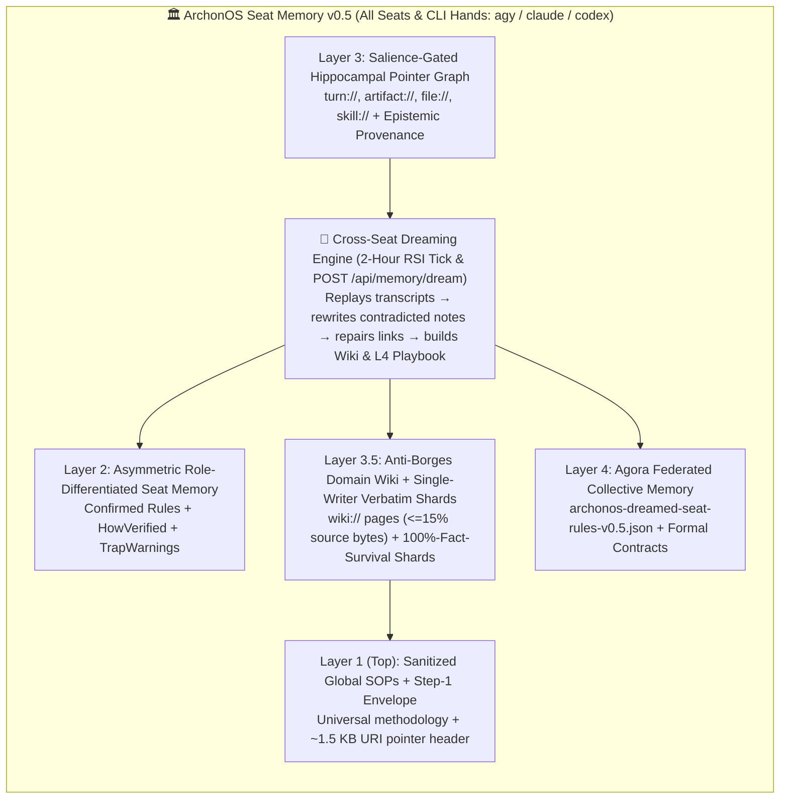

# ArchonOS Seat Memory v0.5 Architecture & Comparative Analysis with Anthropic’s *"The Components of Agent Memory"*

**[English](./archon-seat-memory-v0.5-architecture.md)** | **[简体中文](./archon-seat-memory-v0.5-architecture.zh-CN.md)**

> [!NOTE]
> **Reference Sources**
> - **Anthropic Research**: [*"The components of agent memory"*](https://www.anthropic.com/research/components-of-agent-memory) (Published Nov 6, 2026 · Engineering Team, written by Lance Martin)
> - **Foundational Seat Memory v0.3 → v0.4 Architecture (Memory-Prior-to-Skills & Epistemic Pointer Spec)**: [`docs/archon-seat-memory-v0.4-architecture.md`](./archon-seat-memory-v0.4-architecture.md)
> - **ArchonOS Kernel Implementation**: [`packages/archon-worker/src/seat-memory-index.mjs`](../packages/archon-worker/src/seat-memory-index.mjs), [`packages/archon-worker/src/dev-server.mjs`](../packages/archon-worker/src/dev-server.mjs), [`scripts/architect-bridge.mjs`](../scripts/architect-bridge.mjs), and [`packages/archon-worker/test/seat-memory-index.test.mjs`](../packages/archon-worker/test/seat-memory-index.test.mjs)

---

## 1. Executive Summary: What Anthropic’s Research Discovered

Anthropic’s research post starts from Kierkegaard’s observation—*"life can only be understood backward, but it must be lived forward"*—and translates the human brain’s **hippocampal–neocortical memory division** into a 4-tier agent memory architecture powered by **offline "Dreaming" (sleep-time compute)**:

1. **Clear Scope of Agent Memory**: Defined strictly as *knowledge gained from experience retained between sessions as readable context*—explicitly excluding weight updates, single-turn in-context learning, and conversational compaction.
2. **The 4-Tier Memory Stack**:
   - **Bottom Tier — Raw Logs / Transcripts**: Ground-truth chronological records of what actually happened.
   - **Second Tier — In-Session Memory Notes**: Salient facts, hypotheses, and rules written in the moment (`global.md`, `locations/`, `gameplay/`).
   - **Third Tier — Structured Representations (`Wikis`)**: Linked pages + an index built across sessions to map multi-document or multi-session knowledge.
   - **Top Tier — Always-Loaded Injected Context (`MEMORY.md` Header)**: A tightly bounded (≤200 lines / 25 KB) index pre-loaded into every session so the agent knows *what it knows and where to find it*.
3. **Offline Consolidation ("Dreaming")**: During idle periods, background passes replay session transcripts against existing notes to **correct hallucinated/drifted notes** (e.g., fixing the *Pokémon Red* Mt. Moon east/west PokéCenter loop), **build/repair wiki representations** (repointing broken links, adding index pages), and **prune/promote the top-level injected index**.
4. **Six Empirical Findings from CL-Bench 1.0, Pokémon Red, Stainless (420M tokens), & Harvey LAB**:
   - **Salience Judgment Beats Exhaustive Archiving**: In *Pokémon Red*, Sonnet 3.7 wrote 413 files across 225 folders (logging transient screen state like current money/location) and stalled at 1 badge; Fable 5 wrote 9 files + `global.md` focused only on *non-obvious strategy, plans, and tested rules*, earning 4 badges (and Opus 5.5 beat the game).
   - **Memory as a Validated Learning Loop**: On CL-Bench 1.0, weaker models wrote "untested guesses," whereas Opus 4.7 / Sonnet 5 / Opus 5 marked which facts were **confirmed vs. unconfirmed**, recorded *how* they knew a rule was true, and added warnings about traps.
   - **Steer Purpose, Not Rigid Mechanics**: Telling frontier models *what memory is for* works; rigid micro-rules like *"record only failures"* destroyed most of Opus 4.7 and Opus 5’s memory gains. Conversely, explicitly prompting weaker/older models to *"read memory before answering"* nearly doubled their score.
   - **Wikis + Search > Either Alone (With a Borges Caveat)**: Over 128 dreaming sessions on a 350k-file (420M-token) corpus, `Wiki + Search` reached **61%** (saving ~20,000 tokens/question) vs. **53%** for search alone and **48%** for wiki alone. On multi-document synthesis (24 merger questions), `Wiki` scored **87% vs. 73%**. However, on single-document lookup tasks, wikis added zero gain and sometimes suffered the **"Borges Map Trap"**—growing larger than the raw source files.
   - **Multi-Agent Contention Destroys Shared Summaries**: In the Harvey LAB contract benchmark, when multiple agents wrote concurrently to a single shared summary table, they overwrote one another and summarized poorly (**41/57 facts = 72%**). When instructions were evolved via self-reflection so **each agent owned a dedicated per-contract page and quoted terms verbatim**, survival jumped to **57/57 facts (100%)**.

---

## 2. ArchonOS Seat Memory v0.5: Cross-Seat & Multi-Hand Architecture

ArchonOS implements **Seat Memory v0.5** at the OS kernel level so the mandatory pre-seeded **Chief of Staff (`seat:chief-of-staff`)**, **any operator-defined specialist seats** (`seat:<custom-id>` registered dynamically via the Workbench or Chief of Staff), and **all local CLI model hands** (`agy`, `claude`, `codex`) inherit the same hippocampal-to-neocortical memory stack:

### Core Components of Seat Memory v0.5 (`packages/archon-worker/src/seat-memory-index.mjs`)

1. **Cross-Seat & Multi-Hand Salience Gate (`evaluateTurnSalienceForMemory()`)**
   - Filters out transient status/health pings readable from live APIs across `agy`, `claude`, and `codex`, indexing only turns with artifacts/files, verified rules, failure traps, or explicit operator/CoS routing decisions.
2. **Closed-Loop `Rule + Verification + TrapWarning` Extraction (`extractClosedLoopLearningRule()`)**
   - Extracts `ruleStatement`, `howVerified`, `trapWarning`, and `ruleStatus` (`confirmed_rule` vs. `untested_hypothesis` vs. `retracted_or_challenged`) on every pointer across all seats and hands.
3. **Offline Cross-Seat "Dreaming" Consolidation (`dreamConsolidateCrossSeatMemory()`)**
   - Runs automatically during every 2-hour Master RSI tick (`runInfiniteRsiSeatCoordTick`) and on demand via `POST /api/memory/dream` or `node scripts/architect-bridge.mjs dream`.
   - Replays session transcripts across `ws1` and `ws2` to detect and rewrite contradicted notes (`outcome: "corrected_by_dreaming"`), repairs outdated `artifact://` / `skill://` links, merges duplicate alignment rules, and prunes low-salience noise.
4. **Anti-Borges Domain Wiki Builder (`buildCrossSeatDomainWiki()`)**
   - Builds `.archon/memory-wiki/_index.md` and per-seat/domain wiki pages (`wiki://<workspaceId>-<seatId>.md`) only when a domain spans ≥2 signals, enforcing `_index.md <= 150 lines` and `compressionRatio <= 0.15` (`wikiBytes <= 15%` of source bytes).
5. **Single-Writer Verbatim Shard Broker (`upsertSeatVerbatimShard()` & `synthesizeCampaignShards()`)**
   - Enforces Harvey LAB’s `72% → 100%` fact-survival rule: each seat/hand writes exclusively to its own partitioned shard (`shard-<workspaceId>-<campaignId>-<seatId>-<entityId>`) with verbatim quotes (`verbatimQuotes[]` + `primaryFilingHash`) before executive synthesis (`POST /api/memory/shard`, `GET /api/memory/shards`).
6. **Query-Time `Wiki + Verbatim Shard + Pointer` Fusion & L4 Agora Playbook Promotion (`exportDreamedAgoraPlaybook()`)**
   - Fuses L3.5 Domain Wiki pages (`wikiHits[]`), Single-Writer Verbatim Shards (`shardHits[]`), and L3 Execution Pointers (`hits[]`) in a single sub-millisecond pass before every seat/hand execution, and promotes entity-sanitized confirmed rules to `.archon/agora-library/archonos-dreamed-seat-rules-v0.5.json`.
