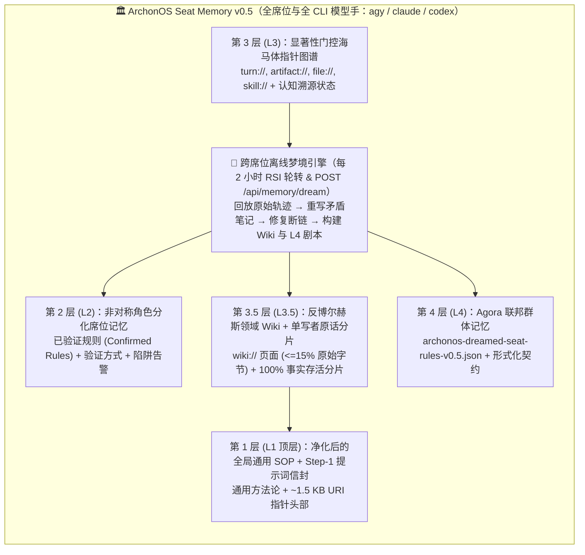

# ArchonOS Seat Memory v0.5 认知记忆架构及与 Anthropic《智能体记忆的构成要素》对比报告

**[English](./archon-seat-memory-v0.5-architecture.md)** | **[简体中文](./archon-seat-memory-v0.5-architecture.zh-CN.md)**

> [!NOTE]
> **参考来源与关联规范**
> - **Anthropic 研究报告**：[*"The components of agent memory"*](https://www.anthropic.com/research/components-of-agent-memory)（2026 年 11 月 6 日发布 · Engineering Team，作者 Lance Martin）
> - **ArchonOS Seat Memory v0.3 → v0.4 基础架构规范（记忆优先于技能与认知指针规范）**：[`docs/archon-seat-memory-v0.4-architecture.zh-CN.md`](./archon-seat-memory-v0.4-architecture.zh-CN.md)
> - **ArchonOS 内核实现**：[`packages/archon-worker/src/seat-memory-index.mjs`](../packages/archon-worker/src/seat-memory-index.mjs)、[`packages/archon-worker/src/dev-server.mjs`](../packages/archon-worker/src/dev-server.mjs)、[`scripts/architect-bridge.mjs`](../scripts/architect-bridge.mjs) 与 [`packages/archon-worker/test/seat-memory-index.test.mjs`](../packages/archon-worker/test/seat-memory-index.test.mjs)

---

## 1. 核心摘要：Anthropic 智能体记忆研究的六大实证发现

Anthropic 的研究从克尔凯郭尔的名言——*“人生只能向后理解，但必须向前生活”*——切入，将人类大脑的**海马体—新皮层（Hippocampal–Neocortical）记忆分工**映射为由**离线“梦境整合（Dreaming / Sleep-Time Compute）”**驱动的四层智能体记忆架构：

1. **明确界定智能体记忆的边界**：严格定义为*从历史经验中习得、并在会话之间以可读上下文形式保留的知识*——显式排除模型权重微调、单回合上下文学习（ICL）与单次会话超长上下文压缩（Compaction）。
2. **四层记忆栈（The 4-Tier Memory Stack）**：
   - **底层 — 原始日志 / 会话轨迹（Raw Logs / Transcripts）**：按时间顺序完整记录实际发生过程的真实底座（Ground Truth）。
   - **第二层 — 会话内记忆笔记（In-Session Memory Notes）**：在任务执行当下记录的显著事实、假设与规则（如 `global.md`、`locations/`、`gameplay/`）。
   - **第三层 — 结构化知识表征（`Wikis`）**：跨多个会话构建的交叉链接主题页面与索引页（`_index.md`），用于映射多文档或多会话综合知识。
   - **顶层 — 常驻预加载上下文（`MEMORY.md` 头部索引）**：严格受限（≤200 行 / 25 KB）的顶层索引，在每次会话启动时预加载，使智能体第一时间明确*“自己知道什么、以及去哪里查找细节”*。
3. **离线梦境整合（Offline Consolidation / "Dreaming"）**：在系统空闲周期，后台进程将原始会话轨迹与现有记忆笔记重新比对回放，主动**修正产生幻觉或偏移的错误笔记**（例如修复《精灵宝可梦 红》月见山东西侧宝可梦中心死循环）、**构建与修复 Wiki 断链**，以及**裁剪/晋升顶层常驻索引**。
4. **来自 CL-Bench 1.0、宝可梦红、Stainless（4.2 亿 Token）与 Harvey LAB 的六项核心实证结论**：
   - **显著性判断（Salience Judgment）远胜于全量归档**：在《宝可梦 红》测试中，Sonnet 3.7 在 225 个文件夹下写了 413 个文件（不断记录当前金币、当前坐标等可直接从屏幕读取的瞬态信息），最终卡在第 1 枚徽章；而 Fable 5 仅维护 9 个文件 + `global.md`，只记录*非显而易见的策略、计划与经验证的规则*，顺利拿到 4 枚徽章（Opus 5.5 则直接通关）。
   - **记忆是闭环验证的学习回路**：在 CL-Bench 1.0 上，较弱模型往往把“未经测试的猜测”当成结论写入记忆；而 Opus 4.7 / Sonnet 5 / Opus 5 会明确区分**已验证规则（Confirmed）与未验证假设（Unconfirmed）**，记录规则是*如何被验证的*，并附带**防踩坑告警（Trap Warnings）**。
   - **引导记忆目标，而非僵化的机械微规则**：告诉前沿模型*记忆的用途是什么*效果最佳；而诸如*“只允许记录失败教训”*这类僵化的机械指令反而抹杀了 Opus 4.7 与 Opus 5 的大部分记忆收益。相反，对较弱或较老模型显式提示*“回答前先读取记忆”*可使其得分几乎翻倍。
   - **`Wiki + 检索` 优于单一方式（但需警惕“博尔赫斯地图陷阱”）**：在 35 万文件（4.2 亿 Token）语料库上历经 128 轮离线 Dreaming 后，`Wiki + 检索` 准确率达到 **61%**（每题节省约 20,000 Token），显著优于纯检索（**53%**）与纯 Wiki（**48%**）；在多文档综合（24 道并购分析题）中，Wiki 达到 **87% vs. 73%**。但在单文档精确查找任务上，Wiki 并无增益，甚至可能陷入**“博尔赫斯地图陷阱（Borges Map Trap）”**——生成的摘要体积比原始文件还要庞大。
   - **多智能体并发覆写会摧毁共享摘要（Harvey LAB 72% → 100% 定律）**：在 Harvey LAB 法律合同基准测试中，当多个智能体并发向同一张共享汇总表写入时，彼此覆写与有损摘要导致事实存活率仅 **41/57（72%）**；当通过自反思演进指令、改为**每个智能体独占各自合同分片页面并保留原话引文（Verbatim Quotes）**后，事实存活率跃升至 **57/57（100%）**。

---

## 2. ArchonOS Seat Memory v0.5：全席位与多模型手认知记忆架构

ArchonOS 在操作系统内核层实现了 **Seat Memory v0.5**，使默认预置的**智枢幕僚长（`seat:chief-of-staff`）**、**操作者按需定义的任意专职席位**（通过工作台或幕僚长动态注册的 `seat:<custom-id>`），以及**全部本地 CLI 模型手**（`agy`、`claude`、`codex`）共享同一套海马体—新皮层五层认知记忆栈：

### Seat Memory v0.5 的六大核心组件 (`packages/archon-worker/src/seat-memory-index.mjs`)

1. **跨席位与多模型手显著性门控（`evaluateTurnSalienceForMemory()`）**
   - 自动滤除 `agy`、`claude`、`codex` 日常执行中可从实时 API 直接读取的瞬态状态/健康探针，仅对产出或修改工件/源码、确立已验证规则、暴露失败陷阱或包含显式操作者/幕僚长路由决策的高价值回合建立长期索引。
2. **闭环 `规则 + 验证方式 + 陷阱告警` 三元组抽取（`extractClosedLoopLearningRule()`）**
   - 在全部席位与模型手的每一条高价值记忆指针上结构化提取 `ruleStatement`（核心规则）、`howVerified`（验证方式）、`trapWarning`（防踩坑告警）与 `ruleStatus`（`confirmed_rule` / `untested_hypothesis` / `retracted_or_challenged`）。
3. **跨席位离线“梦境整合（Offline Dreaming）”（`dreamConsolidateCrossSeatMemory()`）**
   - 每 2 小时随主 RSI 轮转（`runInfiniteRsiSeatCoordTick`）自动运行，或通过 `POST /api/memory/dream` / `node scripts/architect-bridge.mjs dream` 按需触发。
   - 跨工作区回放原始会话真值轨迹，自动识别并重写前后矛盾的旧笔记（标记 `outcome: "corrected_by_dreaming"`）、修复指向旧版本的 `artifact://` / `skill://` 断链、合并重复路由对齐规则并裁剪低显著性噪声。
4. **反博尔赫斯领域 Wiki 构建器（`buildCrossSeatDomainWiki()`）**
   - 仅当某席位/领域积累 ≥2 条显著信号时生成 `.archon/memory-wiki/_index.md` 与主题页（`wiki://<workspaceId>-<seatId>.md`），在内核层强制执行 `_index.md <= 150 行` 且压缩率 `compressionRatio <= 0.15`（Wiki 总字节数不超过原始轨迹字节数的 `15%`）。
5. **单写者原话分片代理（`upsertSeatVerbatimShard()` & `synthesizeCampaignShards()`）**
   - 严格落实 Harvey LAB `72% → 100%` 事实存活定律：每个席位/模型手仅向其独占分片（`shard-<workspaceId>-<campaignId>-<seatId>-<entityId>`）追加写入一手原话引文（`verbatimQuotes[]` + `primaryFilingHash`），禁止跨席位并发覆写或有损改写，在战役收口时由系统确定性聚合（`POST /api/memory/shard`、`GET /api/memory/shards`）。
6. **查询时 `Wiki + 原话分片 + 指针` 三路融合与 L4 Agora 联邦剧本晋升（`exportDreamedAgoraPlaybook()`）**
   - 在任意席位与模型手执行前的 Step-1 亚毫秒级检索中，单次融合 **L3.5 领域 Wiki（`wikiHits[]`）+ 单写者原话分片（`shardHits[]`）+ L3 认知指针（`hits[]`）**，并将跨席位验证通过的高置信度规则（`confidence >= 0.90`，经实体脱敏净化后）自动晋升至 `.archon/agora-library/archonos-dreamed-seat-rules-v0.5.json`。
