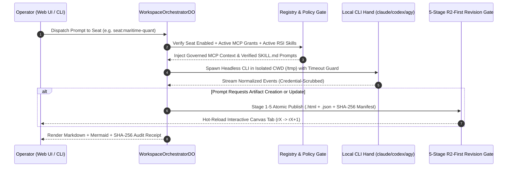

# ArchonOS — System Architecture & Formal Invariants

**[English](./ARCHITECTURE.md) | [简体中文](../zh-CN/ARCHITECTURE.md)** • **[Back to README](../../README.md)**

---

## 1. Architectural Overview

ArchonOS is designed around a strict separation between the **Governed Orchestration Control Plane** and **Local Headless Execution Hands**, connected through **Default-Deny MCP Policy Gates** and **Atomic Artifact Revision Pipelines**.

---

## 2. Five Core Formal Invariants

### Invariant 1: Zero Plaintext Secrets (`archon-registry`)
- Every external MCP server registration (`validateMcpServer`) must reference credentials exclusively via opaque `secret://<id>` handles.
- Any payload containing raw keys (`sk-...`, `Bearer ...`, `ghp_...`, `xoxb-...`) is deterministically rejected before persistence.
- Local CLI output streams pass through `scrub_credentials()` in `packages/archon-hands/adapter.py` before reaching logs or UI clients.

### Invariant 2: Default-Deny MCP Tool Governance (`archon-ledger` & `archon-worker`)
- No Archon Seat can invoke an external MCP tool unless an explicit `(subject, server, tool, allow=true)` grant exists in the workspace registry.
- Grant mutations and seat creation require an **Interactive Human-Ack** (`origin = "interactive"` with a non-empty `author`), preventing autonomous prompt-injection privilege escalation.

### Invariant 3: Harness2 Disjoint Held-Out Skill Gate (`archon-skills`)
- Self-authored or CLI-synthesized skills enter the registry in `state = "proposed"` with `activatable = false`.
- `evaluateSkillProposal()` computes a 3-valued epistemic verdict (`pass | fail | insufficient`):
  1. `verifierAuthoredWithProposal` must be `false`, and `verifierHash` must belong to `preExistingVerifierHashes`.
  2. `heldOut` trajectories must have **zero overlap** with `fitTrajectories`.
  3. At least $n \ge 2$ distinct held-out trajectories must each have $k = 3$ replay samples with 100% pass agreement.
  4. Any unanswered defeater (`grant-widening`, `safety-regression`, `heldout-contamination`) forces `fail`.

### Invariant 4: 5-Stage R2-First Atomic Artifact Publication (`archon-canvas`)
- Every Canvas Artifact revision (`publishArtifactRevision`) executes 5 ordered stages:
  1. **Stage 1 (Immutable Blob Write)**: Write the HTML renderer and JSON dataset blobs first.
  2. **Stage 2 (Manifest SHA-256 Verification)**: Verify blob digest matches the canonical manifest SHA-256.
  3. **Stage 3 (Accessible HTML Parity)**: Require a non-empty accessible HTML fallback (`<table>` or `<section>`) alongside any WebGL/3D canvas.
  4. **Stage 4 (Optimistic Pointer Swap)**: Advance `currentRevision` (`rX → rX+1`) only if `expectedPrevRevision` matches; otherwise return `409 Conflict` for rebase.
  5. **Stage 5 (Broadcast)**: Emit `ARCHON_ARTIFACT_UPDATED` to hot-reload connected Canvas frames.

### Invariant 5: Portable Headless CLI Isolation (`local-hands-runner.mjs`)
- Local CLI binaries (`claude`, `codex`, `agy`, `opencode`) are spawned in an isolated neutral working directory (`/tmp`) with `stdin: 'ignore'` so stale `.claude` / `.gemini` workspace locks or interactive Y/N prompts never hang headless execution.
- Rolling telemetry tracks per-engine runs, average latency, timeouts, and circuit-breaker state (`CLOSED (HEALTHY)` vs `HALF-OPEN (DEGRADED)`).
