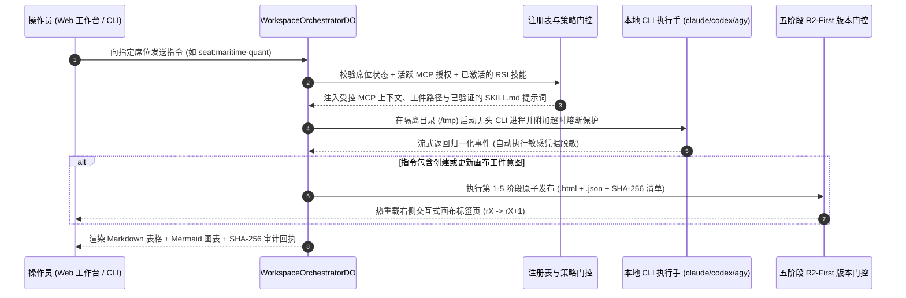

# ArchonOS — 系统架构与形式化安全不变量详解

**[English](../en/ARCHITECTURE.md) | [简体中文](./ARCHITECTURE.md)** • **[返回总览 README](../../README.zh-CN.md)**

---

## 1. 总体架构设计

ArchonOS 采用**受控编排控制面（Governed Control Plane）**与**本地无头执行手（Local Headless Hands）**严格解耦的架构，通过**默认拒绝（Default-Deny）MCP 策略门控**与**五阶段 R2-First 原子画布发布流水线**实现端到端可验证的智能体协同。

---

## 2. 五大核心形式化安全不变量

### 不变量一：零明文密钥入库 (`archon-registry`)
- 所有外部 MCP 服务注册（`validateMcpServer`）必须且只能通过不透明句柄 `secret://<id>` 引用凭据。
- 任何包含原始私钥或 Token（如 `sk-...`、`Bearer ...`、`ghp_...`、`xoxb-...`）的请求都会在注册表校验层被确定性拒绝。
- 本地 CLI 的标准输出流在进入日志或前端界面前，均强制经过 `packages/archon-hands/adapter.py` 中的 `scrub_credentials()` 自动脱敏。

### 不变量二：默认拒绝（Default-Deny）的 MCP 权限门控 (`archon-ledger` & `archon-worker`)
- 除非工作区注册表中存在显式的 `(subject, server, tool, allow=true)` 授权记录，否则任何席位调用外部 MCP 工具均会返回 `403 Forbidden (Default-Deny)`。
- 权限变更与席位增删强制要求**交互式人工确认（Interactive Human-Ack）**（即请求头具备 `origin = "interactive"` 及非空 `author`），彻底阻断模型通过提示词注入自行提权。

### 不变量三：Harness2 训练/留出集解耦的三值认知技能门控 (`archon-skills`)
- 由模型自动蒸馏或提交的技能初始状态固定为 `state = "proposed"` 且 `activatable = false`。
- `evaluateSkillProposal()` 执行严格的三值认知评估（`pass | fail | insufficient`）：
  1. 验证器不得与提案同源编写（`verifierAuthoredWithProposal === false`），且 `verifierHash` 必须存在于预置可信验证器集合中。
  2. 留出测试轨迹（`heldOut`）与拟合训练轨迹（`fitTrajectories`）必须**零交集**（防止过拟合污染）。
  3. 至少包含 $n \ge 2$ 条独立留出轨迹，且每条轨迹均完成 $k = 3$ 次回放并全部通过。
  4. 任何未解决的反驳因子（如 `grant-widening` 权限扩权、`safety-regression` 安全退化）直接判定为 `fail`。

### 不变量四：五阶段 R2-First 原子画布工件发布 (`archon-canvas`)
- 每次画布工件版本升级（`publishArtifactRevision`）严格按 5 个原子阶段执行：
  1. **阶段 1（不可变 Blob 写入）**：先行写入 HTML 渲染器文件与 JSON 数据集文件。
  2. **阶段 2（Manifest SHA-256 校验）**：校验写入内容的哈希摘要与清单 SHA-256 完全一致。
  3. **阶段 3（无障碍 HTML 对等性校验）**：强制要求任何 3D/WebGL 画布必须同时附带可访问的 HTML 结构化表格（`<table>` 或 `<section>`）。
  4. **阶段 4（乐观并发指针切换）**：仅当 `expectedPrevRevision` 匹配时才将 `currentRevision` 从 `rX` 推进至 `rX+1`；若并发冲突则返回 `409 Conflict` 触发变基（Rebase），绝不发生脏写回滚。
  5. **阶段 5（实时广播）**：向前端 iframe 发送 `ARCHON_ARTIFACT_UPDATED` 消息实现无刷新热更新。

### 不变量五：可移植无头 CLI 隔离执行 (`local-hands-runner.mjs`)
- 本地 CLI 二进制文件（`claude`、`codex`、`agy`、`opencode`）统一在中性隔离目录（`/tmp`）且关闭标准输入（`stdin: 'ignore'`）的条件下派生执行，彻底避免因工作区陈旧锁文件或交互式确认提示导致的进程挂起。
- 内置滚动遥测引擎实时统计各 CLI 的调用次数、平均耗时、超时次数与熔断器健康状态（`CLOSED (HEALTHY)` 或 `HALF-OPEN (DEGRADED)`）。
